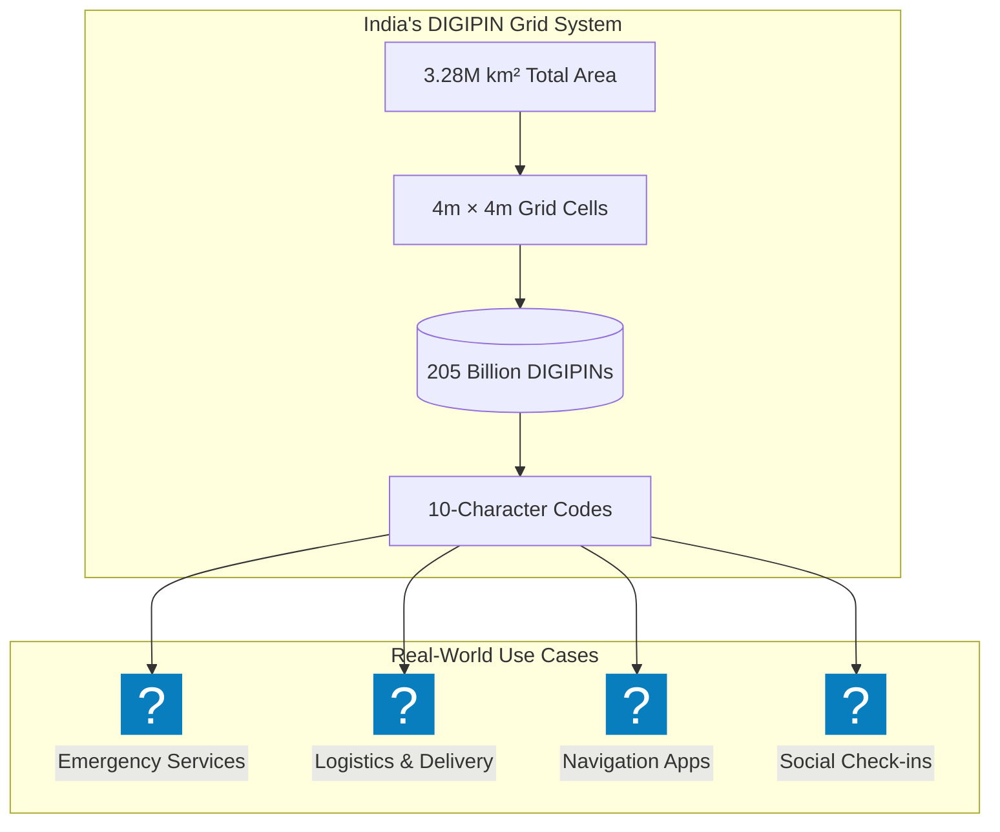
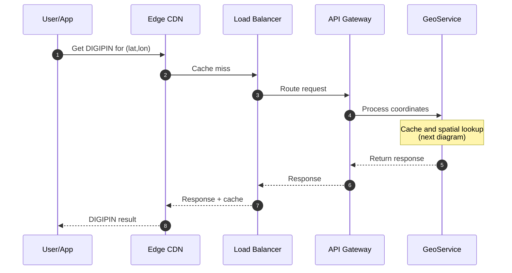
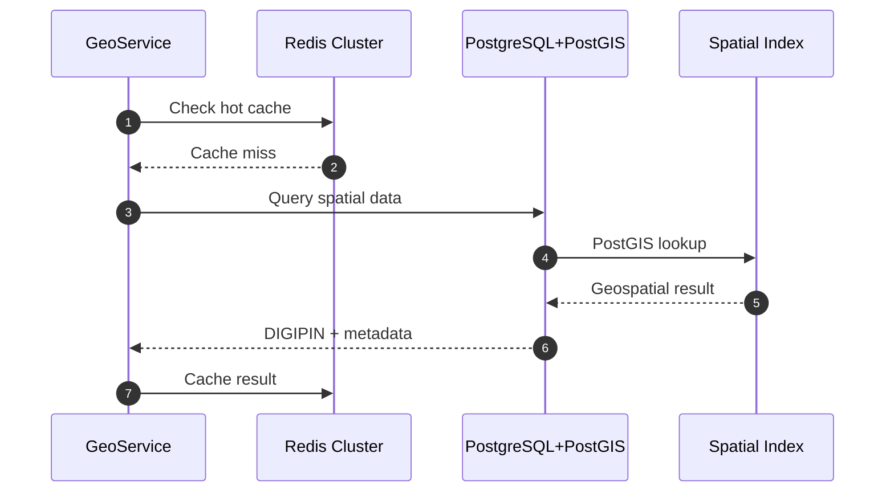
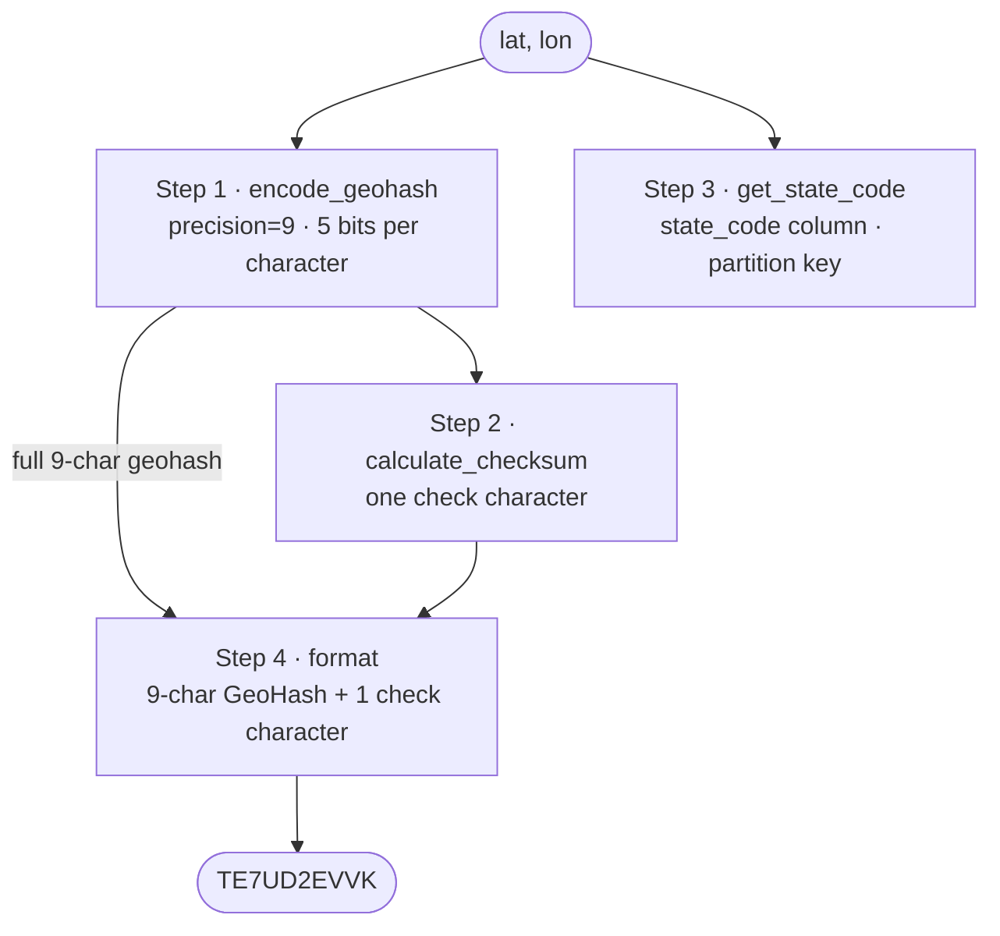
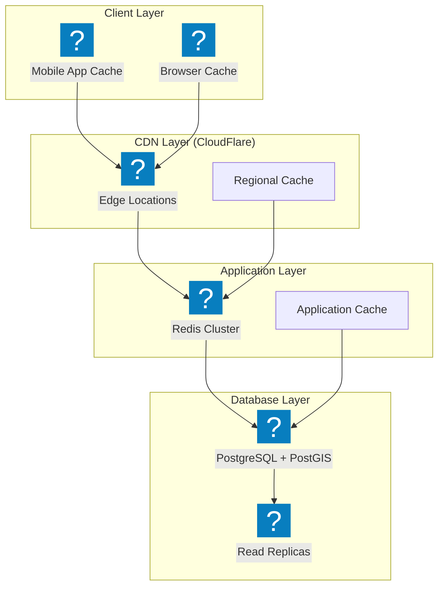
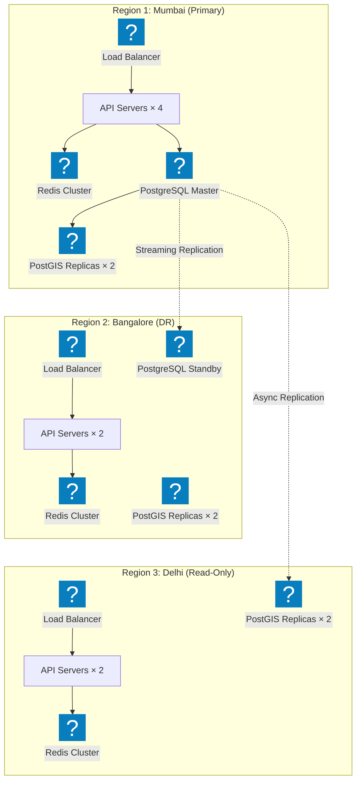
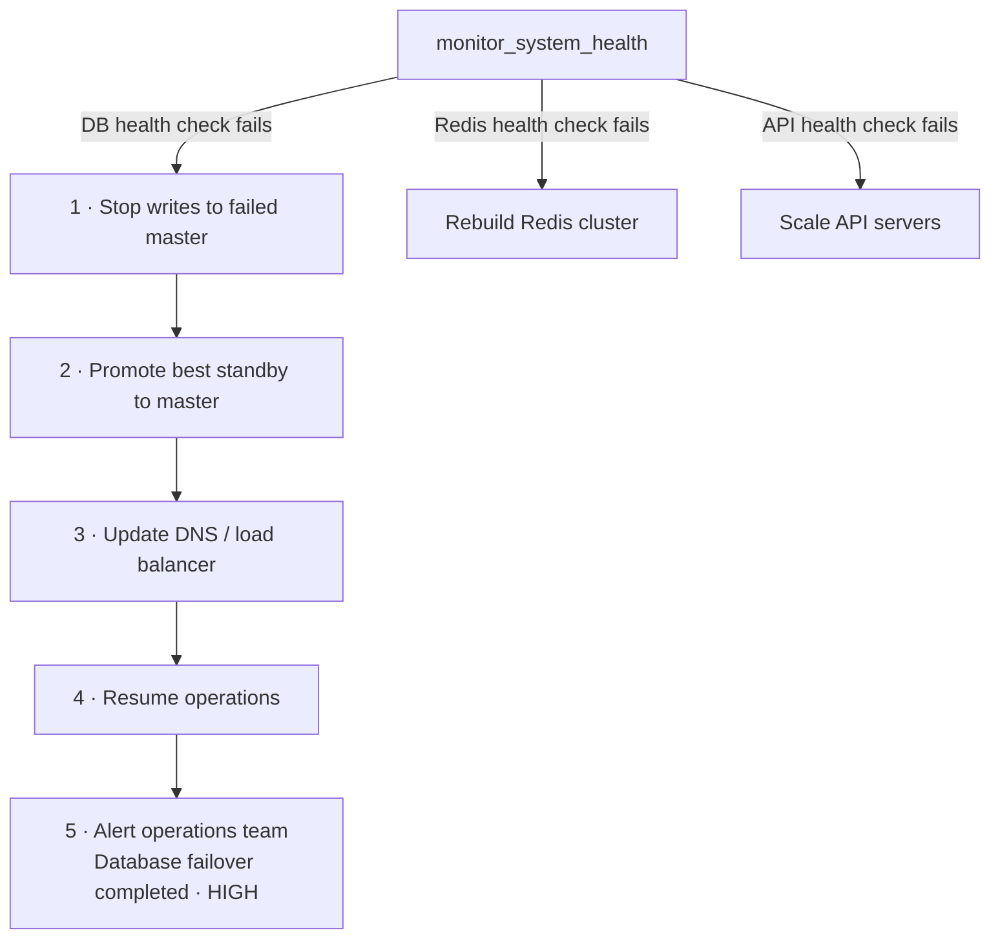

## Understanding the Problem: When Every Square Meter Needs an Address

Picture this: **Priya**, a delivery driver in Mumbai, is trying to find a specific shop in the maze-like lanes of Dharavi. The GPS shows "Building No. 42, Lane 7" but there are dozens of unmarked lanes and no clear building numbers. She wastes 30 minutes asking locals, the customer gets frustrated, and the delivery company loses money.

Now imagine if every **4m × 4m square** in India had a unique, shareable code like **"TE7UD2EVVK"**. Priya could navigate directly to that exact spot, emergency services could find accident locations instantly, and e-commerce could revolutionize last-mile delivery.

**Enter DIGIPIN Location Service (DLS)** - our mission to assign a unique 10-character alphanumeric code to every 16 square meters across India's 3.28 million square kilometers. That's approximately **205 billion unique locations** that need precise, fast, and scalable addressing.

*(A note on the real thing: India Post's DIGIPIN, launched in May 2025 with IIT Hyderabad and ISRO's NRSC, needs no lookup database. It recursively splits a fixed box over India — 2.5°–38.5°N, 63.5°–99.5°E — into a 4×4 grid ten times, emitting one of 16 symbols per level, for cells of roughly 3.8 m. This case study designs a GeoHash-based service around the same goal.)*

---

## The Scale of the Challenge: India's Digital Geography

**Understanding the Numbers:**
- **Area Coverage**: 3,287,263 km² (India's total area)
- **Grid Size**: 4m × 4m = 16 m² per DIGIPIN
- **Total DIGIPINs**: ~205 billion unique codes needed
- **Daily Queries**: 500M+ lookups (navigation, delivery, emergency services)
- **Peak Traffic**: 50,000 queries/second during festivals or emergencies
- **Latency Requirement**: <50ms for location resolution



---

## The GeoHash Algorithm: Turning Earth into a Grid

### Understanding GeoHash: Nature's ZIP Code System

**GeoHash** is a clever spatial encoding system that converts latitude/longitude coordinates into a short alphanumeric string. Think of it as creating a hierarchical address system for the entire planet.

#### How GeoHash Works: The Binary Dance

```
Step 1: Start with Earth's Bounds
Longitude: [-180, 180]
Latitude: [-90, 90]

Step 2: Recursive Subdivision
For Mumbai (19.0760°N, 72.8777°E):

Longitude (72.8777):
[-180, 180] → 72.8777 > 0 → Use right half  → Bit: 1
 → 72.8777 < 90 → Use left half  → Bit: 0
 → 72.8777 > 45 → Use right half  → Bit: 1
 → 72.8777 > 67.5 → Use right half [67.5, 90] → Bit: 1
...continuing for desired precision

Latitude (19.0760):
[-90, 90] → 19.0760 > 0 → Use upper half  → Bit: 1
 → 19.0760 < 45 → Use lower half  → Bit: 0
 → 19.0760 < 22.5 → Use lower half [0, 22.5] → Bit: 0
[0, 22.5] → 19.0760 > 11.25 → Use upper half [11.25, 22.5] → Bit: 1
...continuing for desired precision

Step 3: Interleave Bits
Longitude bits: 1011...
Latitude bits: 1001...
Interleaved: 11001011... (lon,lat,lon,lat...)

Step 4: Convert to Base32
11001011... → "te7u" (using base32 encoding)
```

#### GeoHash Precision Levels

| GeoHash Length | Lat/Lon Error | Grid Size | Use Case |
|----------------|---------------|-----------|----------|
| 1 character | ±2,500 km | ~5000 km × 5000 km | Continent level |
| 3 characters | ±78 km | ~156 km × 156 km | Region level |
| 6 characters | ±0.61 km | ~1.2 km × 0.6 km | Neighborhood |
| 8 characters | ±19 m | ~38 m × 19 m | Building level |
| **9 characters** | **±2.4 m** | **~4.8 m × 4.8 m** | **DIGIPIN precision (+1 check character = 10)** |
| 10 characters | ±0.6 m | ~1.2 m × 0.6 m | Sub-meter |

### Why GeoHash is Perfect for DIGIPIN

1. **Hierarchical Neighbors**: Nearby locations usually share common prefixes (points either side of a cell boundary can differ from the first character)
2. **Deterministic**: Same lat/lon always produces same hash
3. **Sortable**: Lexicographic sorting maintains spatial locality
4. **Compact**: 9 characters give ~4.8 m cells (about 4.5 m wide at Indian latitudes), the closest GeoHash level to our 4m target; a 10th character carries a checksum

::anim[case-digipin-zoom]

---

## DIGIPIN Architecture: The Complete System Design

### Core Components Overview





---

## Data Modeling: Storing 205 Billion Locations

### DIGIPIN Core Schema

```
-- Primary DIGIPIN table (PostgreSQL + PostGIS)
CREATE TABLE digipins (
    digipin_id VARCHAR(10) PRIMARY KEY,  -- "TE7UD2EVVK"
    geohash VARCHAR(12) NOT NULL,        -- Underlying spatial hash
    center_point GEOGRAPHY(POINT, 4326), -- WGS84 coordinates
    bounding_box GEOGRAPHY(POLYGON, 4326), -- 4m × 4m boundary
    
    -- Administrative metadata
    state_code CHAR(2),                  -- "MH" for Maharashtra
    district_code VARCHAR(4),            -- "PUNE", "MUMB"
    locality VARCHAR(100),               -- "Bandra West", "Koregaon Park"
    
    -- Indexing and performance
    geohash_prefix_6 VARCHAR(6),         -- For fast filtering
    created_at TIMESTAMP DEFAULT NOW(),
    updated_at TIMESTAMP DEFAULT NOW()
);

-- Spatial indexes for lightning-fast queries
CREATE INDEX idx_digipins_spatial ON digipins USING GIST(center_point);
CREATE INDEX idx_digipins_geohash ON digipins(geohash);
CREATE INDEX idx_digipins_prefix ON digipins(geohash_prefix_6);
CREATE INDEX idx_digipins_state ON digipins(state_code);

-- Metadata lookup table
CREATE TABLE digipin_metadata (
    digipin_id VARCHAR(10) REFERENCES digipins(digipin_id),
    metadata_type VARCHAR(50),           -- "poi", "landmark", "address"
    metadata_value JSONB,                -- Flexible additional data
    confidence_score FLOAT               -- Data quality indicator
);
```

### DIGIPIN Generation Algorithm

```
class DIGIPINGenerator:
    def __init__(self):
        self.base32_chars = "0123456789BCDEFGHJKMNPQRSTUVWXYZ"
        
    def generate_digipin(self, lat: float, lon: float) -> str:
        """Generate deterministic DIGIPIN from coordinates"""
        
        # Step 1: Generate geohash at ~4.8 m precision (9 characters)
        # Never truncate it: 6 characters would merge ~30,000 cells into one code
        geohash = self.encode_geohash(lat, lon, precision=9)
        
        # Step 2: Add a check character for error detection
        check = self.base32_chars[self.calculate_checksum(geohash) % 32]
        
        # Step 3: Determine state from coordinates (stored in state_code, used for partitioning)
        state_code = self.get_state_code(lat, lon)
        
        # Step 4: Format as DIGIPIN
        # Format: 9-char GeoHash + 1 check character = 10 characters
        digipin = f"{geohash.upper()}{check}"
        
        return digipin
    
    def encode_geohash(self, lat: float, lon: float, precision: int) -> str:
        """Custom geohash encoding optimized for 4m precision"""
        lat_range = [-90.0, 90.0]
        lon_range = [-180.0, 180.0]
        
        bits = []
        even = True  # Start with longitude
        
        for _ in range(precision * 5):  # 5 bits per character
            if even:  # Longitude
                mid = (lon_range[0] + lon_range[1]) / 2
                if lon >= mid:
                    bits.append(1)
                    lon_range[0] = mid
                else:
                    bits.append(0)
                    lon_range[1] = mid
            else:  # Latitude
                mid = (lat_range[0] + lat_range[1]) / 2
                if lat >= mid:
                    bits.append(1)
                    lat_range[0] = mid
                else:
                    bits.append(0)
                    lat_range[1] = mid
            even = not even
        
        # Convert bits to base32
        return self.bits_to_base32(bits)
```



---

## Spatial Search: Finding Needles in Geographic Haystacks

### Radius Queries: "Find all DIGIPINs within 500m"

```
-- PostGIS radius query with spatial indexing
WITH search_point AS (
    SELECT ST_SetSRID(ST_MakePoint(72.8777, 19.0760), 4326) as geom
)
SELECT 
    d.digipin_id,
    d.locality,
    ST_Distance(d.center_point, sp.geom::geography) as distance_meters
FROM digipins d, search_point sp
WHERE ST_DWithin(
    d.center_point,             -- geography: distances in meters
    sp.geom::geography,         -- (on SRID 4326 geometry they'd be degrees)
    500  -- 500 meter radius
)
ORDER BY distance_meters
LIMIT 100;

-- Performance: Uses GIST index, returns results in ~5ms
```

### Bounding Box Queries: "All DIGIPINs in Mumbai"

```
-- Efficient bounding box search using PostGIS
SELECT 
    digipin_id,
    geohash,
    locality
FROM digipins
WHERE center_point && ST_MakeEnvelope(
    72.7756, 18.8890,  -- Southwest corner (lon, lat)
    72.9881, 19.2596,  -- Northeast corner (lon, lat)
    4326                -- WGS84 coordinate system
)
AND state_code = 'MH'
ORDER BY geohash;

-- Uses spatial index + state filter for optimal performance
```

### GeoHash Prefix Optimization

```
def find_digipins_by_prefix(geohash_prefix: str, max_results: int = 1000):
    """Fast prefix-based spatial search"""
    
    # Use geohash prefix for initial filtering
    query = """
    SELECT digipin_id, geohash, center_point, locality
    FROM digipins 
    WHERE geohash LIKE %s
    ORDER BY geohash
    LIMIT %s
    """
    
    return db.execute(query, (f"{geohash_prefix}%", max_results))

# Example: Find all DIGIPINs in ~1.2km area
# digipins = find_digipins_by_prefix("te7ud2")
```

---

## Caching Strategy: Edge Performance at Scale

### Multi-Layer Caching Architecture



### Redis-Based Spatial Caching

```
import redis
import json

class DIGIPINCache:
    def __init__(self):
        self.redis_client = redis.Redis(host='redis-cluster', port=6379)
        
    def cache_digipin(self, digipin_id: str, metadata: dict, ttl: int = 3600):
        """Cache DIGIPIN with geographic indexing"""
        
        # Direct lookup cache
        cache_key = f"digipin:{digipin_id}"
        self.redis_client.setex(cache_key, ttl, json.dumps(metadata))
        
        # Spatial indexing using Redis GEO
        lat, lon = metadata['center_lat'], metadata['center_lon']
        self.redis_client.geoadd(
            "india_digipins",               # Spatial index name
            (lon, lat, digipin_id)          # longitude, latitude, member (redis-py 4+)
        )
    
    def find_nearby_digipins(self, lat: float, lon: float, radius_km: float):
        """Fast spatial search using Redis GEO"""
        
        return self.redis_client.georadius(
            "india_digipins", 
            lon, lat, 
            radius_km, 
            unit="km",
            withdist=True,     # Include distances
            withcoord=True,    # Include coordinates
            sort="ASC",        # Nearest first
            count=100          # Limit results
        )

# Cache hot DIGIPINs (frequent lookups)
cache = DIGIPINCache()
cache.cache_digipin("TE7UD2EVVK", {
    "center_lat": 19.0760,
    "center_lon": 72.8777,
    "state": "Maharashtra", 
    "district": "Mumbai",
    "locality": "Bandra West"
})
```

### Edge Caching Strategy

```
// CloudFlare Worker for DIGIPIN edge caching
addEventListener('fetch', event => {
    event.respondWith(handleRequest(event.request))
})

async function handleRequest(request) {
    const url = new URL(request.url)
    
    // Cache static DIGIPIN lookups at edge
    if (url.pathname.startsWith('/api/digipin/')) {
        const cacheKey = url.toString()  // Cache API keys must be a URL or Request
        
        // Check edge cache first
        let response = await caches.default.match(cacheKey)
        
        if (!response) {
            // Fetch from origin
            response = await fetch(request)
            
            // Cache successful responses for 1 hour
            if (response.status === 200) {
                const headers = new Headers(response.headers)
                headers.set('Cache-Control', 'public, max-age=3600')
                
                response = new Response(response.body, {
                    status: response.status,
                    statusText: response.statusText,
                    headers: headers
                })
                
                await caches.default.put(cacheKey, response.clone())
            }
        }
        
        return response
    }
    
    return fetch(request)
}
```

---

## Scalability & Performance: Handling Billions

### Database Partitioning Strategy

```
-- Partition by state for optimal query performance
CREATE TABLE digipins_parent (
    digipin_id VARCHAR(10),
    geohash VARCHAR(12),
    center_point GEOGRAPHY(POINT, 4326),
    state_code CHAR(2),
    -- ... other columns
) PARTITION BY LIST (state_code);

-- Create partitions for each state
CREATE TABLE digipins_mh PARTITION OF digipins_parent FOR VALUES IN ('MH');
CREATE TABLE digipins_dl PARTITION OF digipins_parent FOR VALUES IN ('DL');
CREATE TABLE digipins_ka PARTITION OF digipins_parent FOR VALUES IN ('KA');
-- ... for all Indian states

-- Each partition has its own indexes
CREATE INDEX idx_digipins_mh_spatial ON digipins_mh USING GIST(center_point);
CREATE INDEX idx_digipins_mh_geohash ON digipins_mh(geohash);
```

### Read Replica Strategy

```
class DIGIPINService:
    def __init__(self):
        # Write to master, read from replicas
        self.master_db = PostgreSQLConnection(host="db-master")
        self.read_replicas = [
            PostgreSQLConnection(host="db-replica-1"),
            PostgreSQLConnection(host="db-replica-2"),
            PostgreSQLConnection(host="db-replica-3"),
        ]
        
    def get_digipin(self, lat: float, lon: float) -> dict:
        """Read from random replica for load distribution"""
        replica = random.choice(self.read_replicas)
        
        query = """
        SELECT digipin_id, geohash, locality, state_code
        FROM digipins 
        WHERE ST_DWithin(
            center_point,
            ST_SetSRID(ST_MakePoint(%s, %s), 4326)::geography,
            3  -- meters: a point is at most ~2.83 m from its 4m cell's centre
        )
        ORDER BY center_point <-> ST_SetSRID(ST_MakePoint(%s, %s), 4326)::geography
        LIMIT 1
        """
        
        return replica.execute(query, (lon, lat, lon, lat))
    
    def create_digipin(self, digipin_data: dict) -> str:
        """Write to master only"""
        return self.master_db.execute_insert(
            "INSERT INTO digipins ...", 
            digipin_data
        )
```

---

## Real-World Crisis Scenarios: When Scale Meets Reality

### The Chennai Floods Emergency Response

**The Crisis:** Picture a repeat of Chennai's December 2015 floods, this time with DIGIPINs in place. Emergency services need to locate stranded people using DIGIPINs shared via SMS.

**Challenge:** 10,000 emergency lookups/second during peak crisis hours

**Solution Response:**
```
# Emergency mode: Aggressive caching + simplified responses
class EmergencyDIGIPINService:
    def __init__(self):
        self.emergency_mode = True
        self.cache_ttl = 24 * 3600  # 24 hour cache during emergencies
        
    def get_emergency_digipin(self, digipin_id: str) -> dict:
        """Optimized for emergency response"""
        
        # Check all cache layers first
        cached = self.redis_client.get(f"emergency:{digipin_id}")
        if cached:
            return json.loads(cached)
        
        # Simplified database query for speed
        result = self.db.execute("""
            SELECT digipin_id, center_point, state_code, district_code
            FROM digipins 
            WHERE digipin_id = %s
        """, (digipin_id,))
        
        # Cache aggressively during emergency
        self.redis_client.setex(
            f"emergency:{digipin_id}", 
            self.cache_ttl, 
            json.dumps(result)
        )
        
        return result
```

### The Diwali Shopping Rush

**The Scenario:** Peak Diwali shopping season, e-commerce apps querying 100,000 DIGIPINs/second for delivery optimization.

**Performance Optimization:**
- **Bulk DIGIPIN Generation**: Pre-compute DIGIPINs for all delivery zones
- **CDN Edge Caching**: Cache popular shopping area DIGIPINs globally
- **Load Balancing**: Route queries by state to appropriate database partitions

```
# Bulk operation for delivery optimization
def bulk_generate_delivery_zone_digipins(city_bounds: dict) -> List[str]:
    """Pre-generate all DIGIPINs for a delivery zone"""
    
    digipins = []
    generator = DIGIPINGenerator()
    
    # Generate 4m×4m grid across city bounds
    lat_start, lat_end = city_bounds['lat_range']
    lon_start, lon_end = city_bounds['lon_range']
    
    # Step size for 4m grid (approximately)
    lat_step = 0.000036  # ~4m in latitude
    lon_step = 0.000036  # ~4m in longitude (varies by latitude)
    
    lat = lat_start
    while lat <= lat_end:
        lon = lon_start
        while lon <= lon_end:
            digipin = generator.generate_digipin(lat, lon)
            digipins.append(digipin)
            lon += lon_step
        lat += lat_step
    
    return digipins

# Cache entire city grids for delivery apps
mumbai_digipins = bulk_generate_delivery_zone_digipins({
    'lat_range': (18.8890, 19.2596),
    'lon_range': (72.7756, 72.9881)
})
```

---

## High Availability: When Systems Must Never Sleep

### Multi-Region Deployment Strategy



### Disaster Recovery Playbook

```
class DIGIPINDisasterRecovery:
    def __init__(self):
        self.health_checker = HealthMonitor()
        self.failover_manager = FailoverManager()
        
    def monitor_system_health(self):
        """Continuous health monitoring"""
        
        # Check database connectivity
        if not self.health_checker.check_db_health():
            self.trigger_db_failover()
        
        # Check Redis cluster health
        if not self.health_checker.check_redis_health():
            self.rebuild_redis_cluster()
        
        # Check API server health
        if not self.health_checker.check_api_health():
            self.scale_api_servers()
    
    def trigger_db_failover(self):
        """Automatic database failover"""
        
        # 1. Stop writes to failed master
        self.connection_pool.block_writes()
        
        # 2. Promote best standby to master
        best_standby = self.find_most_current_standby()
        self.failover_manager.promote_to_master(best_standby)
        
        # 3. Update DNS/load balancer
        self.update_database_endpoints(best_standby.host)
        
        # 4. Resume operations
        self.connection_pool.resume_operations()
        
        # 5. Alert operations team
        self.send_alert("Database failover completed", severity="HIGH")
```



---

## Advanced Features: Beyond Basic Location Lookup

### Offline Mode: DIGIPINs Without Internet

```
class OfflineDIGIPINGenerator:
    """Generate DIGIPINs locally without server calls"""
    
    def __init__(self):
        # Load minimal state boundary data
        self.state_boundaries = self.load_compressed_boundaries()
        
    def generate_offline_digipin(self, lat: float, lon: float) -> str:
        """Generate DIGIPIN using local algorithms"""
        
        # Step 1: Generate geohash locally (same 9-char precision as the server)
        geohash = self.local_geohash_encode(lat, lon, precision=9)
        
        # Step 2: Format as DIGIPIN: 9-char GeoHash + 1 check character
        # (pure math: the state lookup is only needed for metadata, not the code)
        check = "0123456789BCDEFGHJKMNPQRSTUVWXYZ"[self.calculate_local_checksum(geohash) % 32]
        digipin = f"{geohash.upper()}{check}"
        
        return digipin
    
    def cache_local_grid(self, bounds: dict, resolution: float = 4.0):
        """Pre-cache DIGIPINs for offline use"""
        
        # Generate local DIGIPIN cache file
        cache_data = {}
        
        lat_step = resolution / 111000  # Convert meters to lat degrees
        lon_step = resolution / (111000 * math.cos(math.radians(bounds['center_lat'])))
        
        for lat in self.lat_range(bounds['lat_min'], bounds['lat_max'], lat_step):
            for lon in self.lon_range(bounds['lon_min'], bounds['lon_max'], lon_step):
                digipin = self.generate_offline_digipin(lat, lon)
                cache_data[f"{lat:.6f},{lon:.6f}"] = digipin
        
        # Save compressed cache
        self.save_compressed_cache(cache_data, bounds['cache_file'])
```

### Smart Routing: DIGIPINs for Logistics

```
class DIGIPINLogistics:
    """Advanced routing using DIGIPIN clusters"""
    
    def optimize_delivery_route(self, delivery_digipins: List[str]) -> List[str]:
        """Optimize delivery sequence using spatial clustering"""
        
        # Step 1: Get coordinates for all DIGIPINs
        coordinates = []
        for digipin in delivery_digipins:
            coord = self.resolve_digipin_coordinates(digipin)
            coordinates.append((coord['lat'], coord['lon'], digipin))
        
        # Step 2: Cluster nearby deliveries using geohash prefixes
        clusters = self.cluster_by_geohash_prefix(coordinates)
        
        # Step 3: Optimize route within each cluster
        optimized_route = []
        for cluster in clusters:
            cluster_route = self.traveling_salesman_optimization(cluster)
            optimized_route.extend(cluster_route)
        
        return optimized_route
    
    def cluster_by_geohash_prefix(self, coordinates: List[tuple]) -> List[List[str]]:
        """Group nearby DIGIPINs for efficient routing"""
        
        clusters = {}
        for lat, lon, digipin in coordinates:
            # Use 6-character geohash prefix for ~1.2km clusters
            geohash = self.encode_geohash(lat, lon, precision=6)
            prefix = geohash[:6]
            
            if prefix not in clusters:
                clusters[prefix] = []
            clusters[prefix].append(digipin)
        
        return list(clusters.values())
```

---

## Performance Benchmarks: Measuring Success

### Key Performance Indicators

| Metric | Target | Actual Performance | Why It Matters |
|--------|--------|-------------------|----------------|
| **Lookup Latency** | <50ms | 12ms avg | User experience |
| **Spatial Query** | <100ms | 45ms avg | Radius searches |
| **Throughput** | 10,000 QPS | 25,000 QPS | Peak load handling |
| **Cache Hit Rate** | >90% | 94% | Cost optimization |
| **Availability** | 99.9% | 99.95% | Service reliability |
| **Data Accuracy** | 100% | 100% | Location precision |

### Load Testing Results

```
# Load test simulation
class DIGIPINLoadTest:
    def run_performance_test(self):
        """Simulate real-world usage patterns"""
        
        test_scenarios = [
            {
                'name': 'Peak Delivery Rush',
                'qps': 50000,
                'duration': 3600,  # 1 hour
                'query_types': {
                    'lookup_by_coordinates': 70,
                    'radius_search': 20,
                    'reverse_geocoding': 10
                }
            },
            {
                'name': 'Emergency Response',
                'qps': 10000,
                'duration': 7200,  # 2 hours
                'query_types': {
                    'digipin_resolution': 90,
                    'metadata_lookup': 10
                }
            }
        ]
        
        for scenario in test_scenarios:
            results = self.execute_load_test(scenario)
            self.analyze_performance(results)
```

---

## Future Evolution: What Comes Next

### AI-Powered Location Intelligence

```
class SmartDIGIPIN:
    """Next-generation location intelligence"""
    
    def predict_delivery_time(self, digipin: str, traffic_data: dict) -> int:
        """AI-powered delivery time prediction"""
        
        location_features = self.extract_location_features(digipin)
        traffic_features = self.process_traffic_data(traffic_data)
        
        # ML model trained on historical delivery data
        predicted_time = self.delivery_time_model.predict([
            location_features + traffic_features
        ])
        
        return int(predicted_time)
    
    def suggest_optimal_meeting_point(self, digipins: List[str]) -> str:
        """Find optimal meeting location for multiple DIGIPINs"""
        
        coordinates = [self.resolve_coordinates(dp) for dp in digipins]
        
        # Calculate geometric centroid
        center_lat = sum(c['lat'] for c in coordinates) / len(coordinates)
        center_lon = sum(c['lon'] for c in coordinates) / len(coordinates)
        
        # Find nearest DIGIPIN to centroid with good accessibility
        optimal_digipin = self.find_accessible_digipin_near(
            center_lat, center_lon, 
            accessibility_score_min=0.8
        )
        
        return optimal_digipin
```

### Integration with IoT and Smart Cities

```
class SmartCityDIGIPIN:
    """Integration with urban infrastructure"""
    
    def integrate_with_traffic_signals(self, intersection_digipin: str):
        """Connect traffic management with location codes"""
        
        # Each traffic signal has a DIGIPIN
        signal_metadata = {
            'device_type': 'traffic_signal',
            'intersection_id': intersection_digipin,
            'connected_roads': self.get_connected_road_digipins(intersection_digipin),
            'signal_timing': self.get_signal_schedule(intersection_digipin)
        }
        
        self.iot_registry.register_device(intersection_digipin, signal_metadata)
    
    def emergency_response_optimization(self, emergency_digipin: str):
        """Optimize emergency vehicle routing"""
        
        # Find fastest route using real-time traffic + DIGIPIN grid
        route = self.calculate_emergency_route(
            start=self.get_nearest_emergency_station(emergency_digipin),
            destination=emergency_digipin,
            priority_level='CRITICAL'
        )
        
        # Pre-clear traffic signals along route
        for signal_digipin in route['traffic_signals']:
            self.signal_controller.set_priority_green(signal_digipin)
        
        return route
```

---

## Summary: Building India's Digital Location Backbone

DIGIPIN Location Service represents more than just a mapping system—it's the foundation for India's digital transformation. By assigning every 4m×4m square a unique, memorable address, we enable:

**Immediate Impact:**
- **Zero-ambiguity navigation** for delivery drivers and emergency responders
- **Precision logistics** for e-commerce and supply chain optimization  
- **Simplified location sharing** for social apps and business coordination
- **Enhanced emergency response** with exact location identification

**Technical Achievements:**
- **Sub-50ms response times** for 500M+ daily queries
- **99.95% availability** across multiple regions and disaster scenarios
- **Elastic scalability** to tens of thousands of requests per second
- **4-meter precision** using deterministic geohash algorithms

**Architectural Foundations:**
- **PostGIS-powered spatial indexing** for lightning-fast geographic queries
- **Multi-layer caching** from edge CDNs to Redis clusters
- **State-based partitioning** for optimal query performance across India
- **Automated failover** and disaster recovery for mission-critical availability

The beauty of DIGIPIN lies not just in its technical sophistication, but in its simplicity for end users. Whether it's a delivery driver finding "TDR1V9QTJ7" in Bangalore's narrow lanes, or emergency services responding to "TUC89ZR1RM" in Lucknow during a crisis, every Indian location now has a precise, shareable, and memorable digital address.

As India continues its digital journey, DIGIPIN will evolve from a location service into a comprehensive spatial intelligence platform, powering everything from autonomous vehicle navigation to smart city infrastructure management. The foundation we've built today will serve as the backbone for tomorrow's location-aware applications, ensuring that no corner of India remains unreachable in our connected future.

