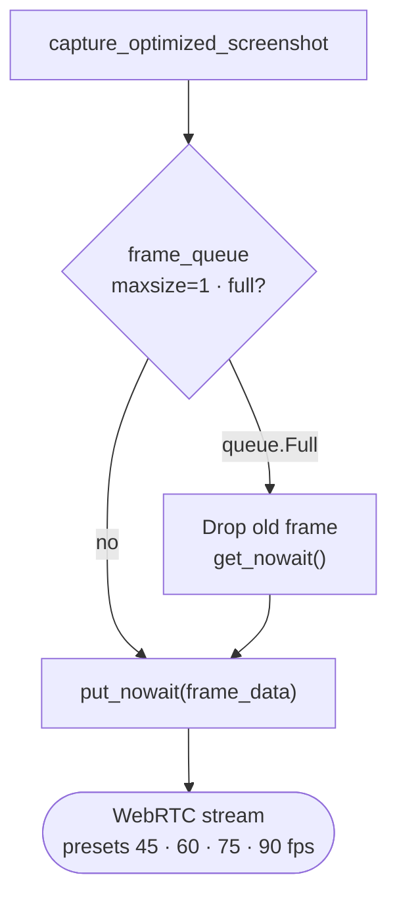
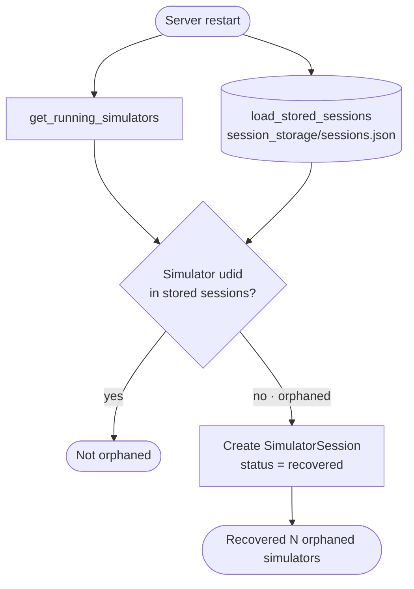
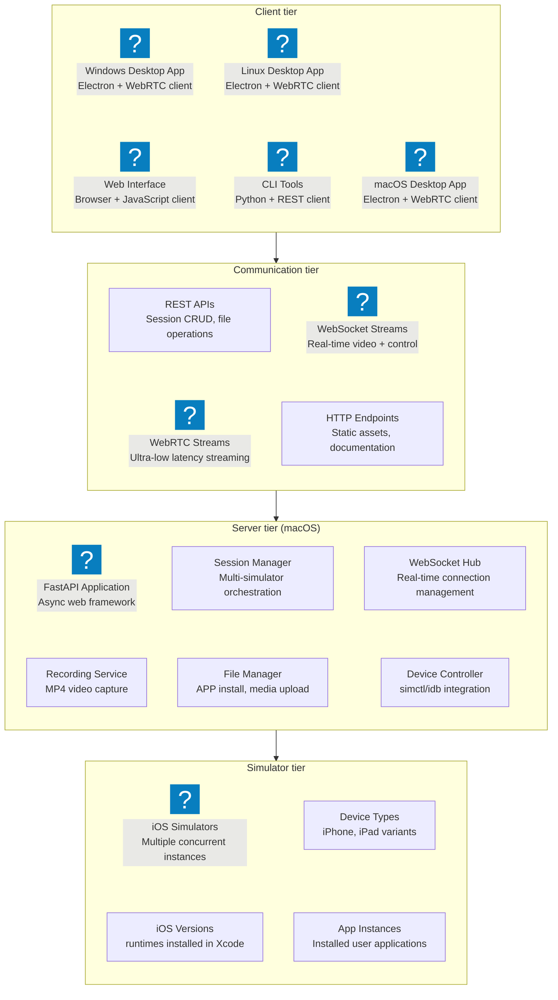
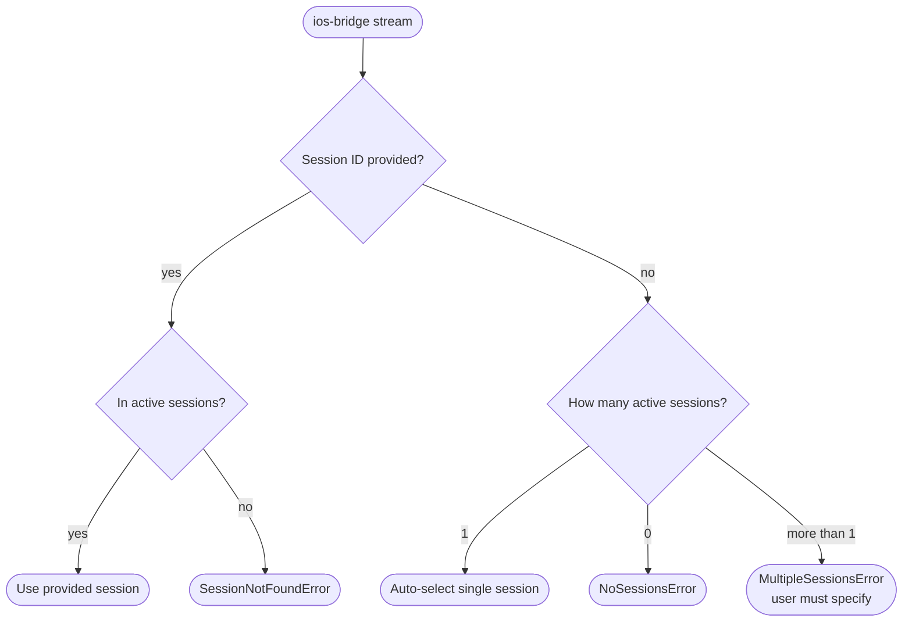

## The Problem: iOS Simulators Only Run on a Mac

I built **iOS Bridge**, an open-source tool ([MIT, on GitHub](https://github.com/himanshkukreja/ios-bridge)) that streams iOS simulators from a Mac to Windows, Linux, another Mac or a browser, with full touch control, app installs and recording.

It exists because of one hard constraint: **the iOS Simulator only runs on macOS, with Xcode.** That's fine for a team of Mac users. It's a bottleneck for everyone else.

*(The team below is an illustration, not a customer.)*

Picture a cross-platform team of eight building a fitness app in React Native. Most of them work on Windows or Linux laptops, and there's one shared MacBook for iOS.

**A typical day (illustrative):**
```
9:00 AM  - Write iOS-specific code on Windows
10:30 AM - Push, wait for CI to build the iOS app
11:15 AM - Build passes, but a layout bug only shows on iPhone
11:45 AM - Queue for the shared Mac
12:30 PM - Finally on the simulator, find three more issues
1:00 PM  - Someone else needs the Mac; testing is half done
```

**The pain points:**
- **8 developers, 1 Mac**: a queue for every iOS check
- **CI as a simulator**: a full build cycle to see a one-line style fix
- **Remote work**: the Mac is in the office, the developers aren't
- **The usual fixes are expensive**: a Mac for everyone, or a rented cloud Mac per developer

**What I wanted instead:** one Mac hosting the simulators, and every developer, on any OS, using them as if they were local.

---

## The Vision: iOS Simulator Streaming as a Service

### The "Aha!" Moment

**The question:** remote desktop tools can already stream an entire Mac. Why not stream just the iOS simulator, with real touch input and app controls, to any OS?

**The Core Insight:**
```
Traditional Approach:
Developer → Physical Mac → Local iOS Simulator

Revolutionary Approach:
Developer (Any Platform) → Network → Mac Server → Streamed iOS Simulator
```

**The Technical Vision:**
1. **Mac Server**: Hosts multiple iOS simulators simultaneously
2. **Streaming Engine**: Real-time video/control streaming (WebRTC + WebSocket)
3. **Cross-Platform Clients**: Native desktop apps for Windows, Linux, macOS
4. **Web Interface**: Browser-based access requiring no installation
5. **Session Management**: Persistent simulator sessions with auto-recovery
6. **Full Control**: Touch, gestures, keyboard, app installation, recording

### The Research Journey: Standing on Giants' Shoulders

Before diving into code, I needed to understand how others had solved similar problems. The Android ecosystem had already cracked this nut beautifully.

**Android's Proven Solutions:**
```bash
# Android Debug Bridge (ADB) - The gold standard
adb devices                    # List connected devices
adb shell input tap 100 200   # Send touch commands
adb shell screencap -p         # Capture screenshots

# scrcpy - The streaming champion  
scrcpy --video-bit-rate 8M --max-size 1920
# Result: Flawless Android device streaming to desktop
```

**The "If Android Can Do It..." Moment:**
Android developers had been enjoying seamless device streaming and control for years through `scrcpy`. Meanwhile, iOS developers were stuck with physical device cables or sharing expensive Mac hardware. The disparity was glaring.

**The iOS Research Deep Dive:**
While exploring iOS automation tools, I discovered **[Meta's idb (iOS Development Bridge)](https://fbidb.io/)** - and everything clicked into place.

**IDB: The Missing iOS Foundation:**
```bash
# IDB capabilities that changed everything:
idb list-targets              # List iOS simulators and devices
idb ui tap 100 200            # Send precise touch commands  
idb screenshot                # Capture high-quality screenshots
idb install app.ipa           # Install iOS applications
idb record-video output.mp4   # Record simulator sessions

# The revelation: iOS had ADB-equivalent power!
```

**The Epiphany:**
- **Android had**: ADB (device control) + scrcpy (streaming) = Perfect developer experience
- **iOS had**: IDB (device control, plus a raw H.264 `video-stream`) + ??? (no scrcpy-style interactive viewer) = Incomplete experience  
- **The opportunity**: Build the missing "scrcpy for iOS" using IDB as the foundation

**Why IDB Became iOS Bridge's Backbone:**
1. **Battle-tested**: Used by Meta for large-scale iOS automation
2. **Comprehensive**: Touch, gestures, app management, video recording
3. **Reliable**: Stable CLI interface with consistent behavior
4. **Open source**: MIT licensed, community-driven development
5. **Active**: Regularly updated with latest iOS support

This research phase was crucial - instead of reinventing device control from scratch, I could focus on the streaming and user experience layers while leveraging IDB's proven automation capabilities.

### Initial Prototype: Proof of Concept

**Weekend 1 - The Basic Setup:**
```python
# Simple FastAPI server with iOS simulator control
from fastapi import FastAPI, WebSocket
import subprocess
import base64

app = FastAPI()

@app.websocket("/ws/{session_id}")
async def websocket_endpoint(websocket: WebSocket, session_id: str):
    await websocket.accept()
    
    while True:
        # Take screenshot of iOS simulator
        screenshot = subprocess.run([
            "xcrun", "simctl", "io", session_id, "screenshot", "--type=png", "-"
        ], capture_output=True)
        
        # Send to client
        encoded = base64.b64encode(screenshot.stdout).decode()
        await websocket.send_json({
            "type": "frame",
            "data": encoded
        })
```

**First success:** a pixelated, choppy stream of an iPhone simulator showing up in a basic HTML page. It was ugly, but it worked!

---

## The Technical Journey: From Prototype to Production

### Challenge 1: The Streaming Quality Crisis

**The Problem:** The first WebSocket version was choppy, a few frames a second, with poor quality and visible lag behind the simulator.

**Failed Approach #1 - Naive Screenshot Streaming:**
```python
# This was painfully slow
def capture_frame():
    # Taking screenshots every 200ms via simctl
    result = subprocess.run([
        "xcrun", "simctl", "io", device_id, "screenshot", "--type=png", "-"
    ], capture_output=True)
    return base64.b64encode(result.stdout)

# Problems (rough per-frame costs):
# - subprocess overhead: ~50ms per call
# - PNG encoding: ~30ms per frame  
# - Base64 encoding: ~20ms per frame
# - Total: ~100ms = max 10 FPS theoretical
```

**The WebRTC Revolution:**
```python
# Breakthrough: WebRTC with optimized frame generation
class FastWebRTCService:
    def __init__(self, session_id, quality="high"):
        self.frame_queue = Queue(maxsize=1)  # Single frame buffer
        self.quality_settings = {  # the real presets in app/main.py
            "low":    {"fps": 45, "resolution": "234x507"},
            "medium": {"fps": 60, "resolution": "312x675"},
            "high":   {"fps": 75, "resolution": "390x844"},
            "ultra":  {"fps": 90, "resolution": "468x1014"}
        }
    
    async def generate_frames(self):
        while self.active:
            # Optimized screenshot capture
            frame_data = self.capture_optimized_screenshot()
            
            # Immediate frame replacement strategy
            try:
                self.frame_queue.put_nowait(frame_data)
            except queue.Full:
                # Drop old frame, always keep newest
                self.frame_queue.get_nowait()
                self.frame_queue.put_nowait(frame_data)
```



**Results:**
- **WebSocket**: choppy, but fine for a quick look
- **WebRTC**: quality presets targeting 45, 60, 75 or 90 FPS (from 234×507 up to 468×1014); the frame rate and latency you actually get depend on the Mac and the network between you
- **Quality**: pick a preset per connection: lower on a weak network, higher on a LAN

::anim[case-ios-bridge-pipeline]

### Challenge 2: Cross-Platform Desktop Apps

**The Electron Solution:**
```javascript
// Real-time touch coordinate translation
class DesktopStreamingApp {
    constructor(config) {
        this.sessionId = config.sessionId;
        this.serverUrl = config.serverUrl;
        this.scaleFactor = 1.0;
    }
    
    handleMouseClick(event) {
        // Translate desktop coordinates to iOS simulator coordinates
        const rect = this.canvas.getBoundingClientRect();
        const x = (event.clientX - rect.left) / this.scaleFactor;
        const y = (event.clientY - rect.top) / this.scaleFactor;
        
        // Send touch command to server
        this.controlSocket.send(JSON.stringify({
            type: "tap",
            x: Math.round(x),
            y: Math.round(y)
        }));
    }
    
    handleVideoStream(frame) {
        // Hardware-accelerated video rendering
        const img = new Image();
        img.onload = () => {
            this.ctx.drawImage(img, 0, 0, 
                this.canvas.width, this.canvas.height);
        };
        img.src = `data:image/jpeg;base64,${frame.data}`;
    }
}
```

### Challenge 3: Session Persistence and Recovery

**The Orphaned Simulator Problem:**
```python
# Before: Server restart = lost simulators
# After: Smart session recovery

class SessionManager:
    def __init__(self):
        self.storage_path = "session_storage/sessions.json"
        
    async def startup_recovery(self):
        """Recover orphaned simulators on server restart"""
        
        # Get all running simulators
        running_simulators = self.get_running_simulators()
        stored_sessions = self.load_stored_sessions()
        
        # Find orphaned simulators (running but not in storage)
        orphaned = []
        for sim in running_simulators:
            if sim.udid not in [s.udid for s in stored_sessions]:
                orphaned.append(sim)
        
        # Create sessions for orphaned simulators
        for orphan in orphaned:
            session = SimulatorSession(
                udid=orphan.udid,
                device_type=orphan.device_type,
                ios_version=orphan.ios_version,
                status="recovered"
            )
            self.sessions[session.session_id] = session
            
        logger.info(f"Recovered {len(orphaned)} orphaned simulators")
```



### Challenge 4: Command Line Interface Design

**The Developer Experience Revolution:**
```bash
# Simple, intuitive commands that "just work"

# Create and stream in 2 commands
ios-bridge create "iPhone 15 Pro" "17.0" --wait
ios-bridge stream

# Cross-platform team setup
# Mac (Server):
ios-bridge start-server --host 0.0.0.0

# Windows/Linux (Clients):
ios-bridge connect http://MAC-IP:8000 --save
ios-bridge stream  # Full feature parity!

# Auto-detection magic
ios-bridge stream  # Automatically finds single session
ios-bridge list    # Shows all sessions with full IDs
ios-bridge terminate  # Smart session detection
```

---



### Core Components

**1. FastAPI Server (The Brain):**
```python
# Complete API surface
@app.post("/api/sessions/create")
async def create_session(device_type: str, ios_version: str):
    # Create iOS simulator with xcrun simctl
    
@app.websocket("/ws/{session_id}/control") 
async def control_websocket(websocket: WebSocket, session_id: str):
    # Real-time touch, swipe, keyboard input
    
@app.websocket("/ws/{session_id}/webrtc")
async def webrtc_websocket(websocket: WebSocket, session_id: str):
    # Ultra-low latency video streaming
    
@app.post("/api/sessions/{session_id}/apps/install")
async def install_app(session_id: str, ipa_file: UploadFile):
    # Install and launch iOS apps
```

**2. Multi-Platform Clients:**
```
Windows: Native Electron app with WebRTC support
Linux:   Native Electron app with full feature parity  
macOS:   Local + remote client capabilities
Web:     Browser-based, mobile-friendly interface
```

**3. Advanced Features:**
```python
# Location simulation
@app.post("/api/sessions/{session_id}/location/set")
async def set_location(session_id: str, lat: float, lng: float):
    # Mock GPS coordinates for location-based testing

# Video recording  
@app.post("/api/sessions/{session_id}/recording/start")
async def start_recording(session_id: str):
    # MP4 recording with automatic download

# File management
@app.post("/api/sessions/{session_id}/media/photos/add")
async def add_photos(session_id: str, photos: List[UploadFile]):
    # Add photos to simulator photo library
```

---

## What It Could Save: The Honest Math

iOS Bridge has 75 stars and 10 forks on GitHub, a small but real community, and I don't have usage numbers beyond that. So here's the math for a team that adopts it, using public prices. These are **potential** savings, not measured results.

### Scenario: 8 developers who need iOS simulators

```
Option A: a Mac for everyone
└── 8 × Mac mini (M4, India launch price ₹59,900)    = ~₹4.8 lakh

Option B: rent a cloud Mac per developer
├── AWS EC2 mac2.metal: ~$0.65/hour, 24-hour minimum per host
├── Always on: ~$475/month each (~₹42,000)
└── 8 developers: ~$3,800/month (~₹3.3 lakh a month)

Option C: one shared Mac + iOS Bridge
├── 1 × Mac mini with more memory (24 GB, ₹99,900)
├── iOS Bridge: free and open source (MIT)
└── Total: ~₹1 lakh, once
```

*(List prices at launch or on AWS's public pages; they change over time. Converted at about ₹88/$.)*

**Potential saving: around ₹3.8 lakh up front against buying everyone a Mac.** For a team that rents instead, one shared cloud Mac (~₹42,000 a month) instead of eight (~₹3.3 lakh) saves nearly ₹3 lakh every month.

And at scale: **if 100 such teams shared one Mac each instead of buying eight, that's roughly ₹3.8 crore of hardware they wouldn't need to buy.**

### Where It Doesn't Replace a Mac

- **Building and signing still need macOS.** iOS Bridge streams simulators; Xcode builds still run on the Mac server or in CI. For React Native or Flutter, the shared Mac can be the build machine too.
- **One Mac has limits.** Every running simulator uses memory and CPU, so how many people can share one machine depends on its RAM and what they run. Measure on your hardware before you plan around a number.
- **Simulators aren't devices.** Camera, Bluetooth, push behaviour and real performance still need physical iPhones.
- **The network matters.** Streaming feels best on a fast, nearby network; across continents, expect more lag.

### What the Illustrative Team Gets Back

```
9:00 AM - Write iOS code on Windows
9:15 AM - ios-bridge stream (the shared Mac's simulator, on screen)
9:16 AM - Test the change live, spot the layout bug
9:18 AM - Fix it, see the result immediately
```

No queue for the Mac, and no CI cycle for a style fix.

---

## Technical Deep Dive: The Magic Behind the Scenes

### WebRTC Streaming Engine

```python
class FastVideoTrack(VideoStreamTrack):
    """Ultra-low latency video streaming"""
    
    def __init__(self, service, target_fps=60):
        super().__init__()
        self.service = service
        self.target_fps = target_fps
        self.frame_interval = 1.0 / target_fps
        self.start_time = time.time()
        self.frame_count = 0
    
    async def recv(self):
        # Precise frame timing for smooth streaming
        target_time = self.start_time + (self.frame_count * self.frame_interval)
        current_time = time.time()
        
        wait_time = target_time - current_time
        if wait_time > 0:
            await asyncio.sleep(wait_time)
        
        # Get latest frame with frame reuse strategy
        frame = await self.service.get_fast_frame()
        
        # Set WebRTC timing metadata
        frame.pts = self.frame_count
        frame.time_base = Fraction(1, self.target_fps)
        
        self.frame_count += 1
        return frame
```

### Smart Session Management

```python
class SmartSessionDetection:
    """Auto-detect and manage sessions intelligently"""
    
    def resolve_session_id(self, provided_id: Optional[str]) -> str:
        sessions = self.get_active_sessions()
        
        if provided_id:
            # Use provided session if valid
            if provided_id in sessions:
                return provided_id
            raise SessionNotFoundError(f"Session {provided_id} not found")
        
        if len(sessions) == 1:
            # Auto-select single session
            session_id = list(sessions.keys())[0]
            logger.info(f"Auto-selected session: {session_id}")
            return session_id
        
        if len(sessions) == 0:
            raise NoSessionsError("No active sessions found")
        
        # Multiple sessions - user must specify
        raise MultipleSessionsError(
            f"Multiple sessions found: {list(sessions.keys())}"
        )
```



### Cross-Platform Desktop App

```javascript
// Electron main process with smart window management
class IOSBridgeApp {
    createWindow() {
        // Auto-scale to device dimensions
        const sessionInfo = this.config.sessionInfo;
        const baseWidth = sessionInfo.stream_width || 390;
        const baseHeight = sessionInfo.stream_height || 844;
        
        // Scale to fit screen while maintaining aspect ratio
        const scaleFactor = this.calculateOptimalScale(baseWidth, baseHeight);
        
        this.mainWindow = new BrowserWindow({
            width: Math.round(baseWidth * scaleFactor),
            height: Math.round(baseHeight * scaleFactor),
            webPreferences: {
                nodeIntegration: false,
                contextIsolation: true,
                preload: path.join(__dirname, 'preload.js')
            }
        });
    }
    
    setupKeyboardShortcuts() {
        // F1-F7 hardware simulation
        globalShortcut.register('F1', () => this.sendCommand('home'));
        globalShortcut.register('F2', () => this.sendCommand('screenshot'));
        globalShortcut.register('F3', () => this.sendCommand('info'));
        // ... more shortcuts
    }
}
```

---

## Lessons Learned: What Worked and What Didn't

### Technical Wins

**1. WebRTC was the Game Changer:**
```
WebSocket streaming: simple and works everywhere, but frames queue up behind each other
WebRTC streaming: built for real-time media, and the newest frame always wins

The difference: the simulator feels like it's on your screen, not a slideshow of it
```

**2. Session Persistence Saves Lives:**
```python
# Server restarts no longer destroy work
# Developers can resume exactly where they left off
# No more "Oh no, I lost my test setup!"
```

**3. Auto-Detection Reduces Friction:**
```bash
# Before: ios-bridge stream abc123-def456-789...
# After:  ios-bridge stream (just works!)
```

### Technical Challenges Overcome

**1. Coordinate Translation Complexity:**
```javascript
// Challenge: Different screen sizes, DPI scaling, device orientations
// Solution: Smart coordinate mapping with device info

function translateCoordinates(mouseX, mouseY, deviceInfo) {
    const scaleX = deviceInfo.stream_width / canvas.clientWidth;
    const scaleY = deviceInfo.stream_height / canvas.clientHeight;
    
    return {
        x: Math.round(mouseX * scaleX),
        y: Math.round(mouseY * scaleY)
    };
}
```

**2. Platform-Specific Quirks:**
```bash
# macOS: Perfect local integration
# Windows: Electron packaging challenges  
# Linux: Font rendering and icon issues
# Solution: Platform-specific build configurations
```

**3. Network Reliability:**
```python
# Challenge: WebSocket disconnections, network hiccups
# Solution: Automatic reconnection with exponential backoff

class ReliableWebSocket:
    async def connect_with_retry(self, max_retries=5):
        for attempt in range(max_retries):
            try:
                await self.connect()
                return
            except ConnectionError:
                wait_time = 2 ** attempt  # Exponential backoff
                await asyncio.sleep(wait_time)
```

### What Didn't Work Initially

**1. H.264 Hardware Encoding:**
```python
# Attempted: H.264 straight from the simulator
# Reality:   simctl offers no live H.264 stream (recordVideo writes to a file); idb's raw
#            H.264 video-stream works, but needs its own decode/transcode pipeline
# Status:    an experimental track reads idb's video-stream (low_latency_webrtc_service.py);
#            the default is still the screenshot-based engine, which is simpler to keep stable
```

**2. Native iOS Device Support:**
```python
# Attempted: Support for physical iOS devices
# Problem: Complex provisioning, device trust, cable requirements
# Decision: Focus on simulator excellence first
```

**3. Multi-User Simultaneous Control:**
```python
# Attempted: Multiple people controlling same simulator
# Problem: Conflicting touch inputs, chaos
# Solution: Single-user sessions with sharing via web interface
```

---

## The Future: What's Next for iOS Bridge

### Current Development Focus

**Streaming Quality Enhancement:**
:::tree[Goals for next version]
- 120 FPS ultra mode for premium hardware
- Adaptive bitrate based on network conditions
- Hardware-accelerated encoding on Apple Silicon
- Sub-30ms latency targets
:::

**Advanced Features Pipeline:**
:::tree[Planned features]
- Multi-device testing — run 5+ simulators simultaneously
- Automated testing integration — Appium, XCTest
- Team collaboration tools — shared sessions, annotations
- Cloud deployment options — AWS, Google Cloud
- iOS device support — physical iPhone/iPad streaming
:::

### Roadmap Ideas (No Dates Promised)

- **Performance:** H.264 from idb as the default path, lower CPU and memory use
- **Scale:** several simulators per user, and load balancing across Mac servers
- **Testing:** Appium and XCTest integration
- **Teams:** shared sessions, SSO, audit logs and permissions

---

## Contributing

### The Project

**Project Stats:**
```
├── GitHub Repository: https://github.com/himanshkukreja/ios-bridge
├── Community: 75 stars, 10 forks
├── CLI: ios-bridge-cli 1.0.10 on PyPI
├── License: MIT (fully open source)
├── Architecture: Python + FastAPI + Electron + WebRTC
└── Platforms: macOS server, Windows/Linux/macOS clients
```

**Community Needs:**
```python
# We especially need help with:
streaming_optimization = [
    "Video codec improvements",
    "Network protocol optimization", 
    "Cross-platform performance tuning"
]

platform_support = [
    "Better Linux desktop integration",
    "Windows installer improvements",
    "macOS native features"
]

features = [
    "Advanced gesture recognition",
    "Automated testing integration",
    "Cloud deployment automation"
]
```

### How to Get Involved

**For Users:**
```bash
# Try it yourself:
pip install ios-bridge-cli
ios-bridge create "iPhone 15 Pro" "17.0" --wait
ios-bridge stream
```

**For Contributors:**
```bash
# Join the development:
git clone https://github.com/himanshkukreja/ios-bridge
cd ios-bridge
pip install -r requirements.txt
```

:::tree[Areas needing help]
- Streaming technology expertise
- Cross-platform desktop development
- WebRTC protocol optimization
- iOS automation improvements
- Documentation and tutorials
:::

---

## Conclusion: Bringing the Simulator to Every Developer

### Where iOS Bridge Is Today

- Open source (MIT) at [github.com/himanshkukreja/ios-bridge](https://github.com/himanshkukreja/ios-bridge), with 75 stars and 10 forks
- `ios-bridge-cli` 1.0.10 on PyPI, with an Electron desktop app for Windows, Linux and macOS, plus a browser interface
- WebSocket and WebRTC streaming with quality presets, recording, app installs, and location and photo tools

### What It Could Become

```
├── Students learning iOS development without buying a Mac each
├── Cross-platform teams sharing one Mac instead of queueing for it
├── Remote teams testing iOS from wherever they work
└── Companies spending on fewer Macs and fewer cloud-Mac hours
```

**Technical Ideas Worth Sharing:**
```
├── Newest-frame-wins streaming that never falls behind
├── Click-to-tap coordinate mapping across screen sizes and DPI
├── Session recovery that survives server restarts
└── Open source, so anyone can take these ideas further
```

### Personal Reflection

Building iOS Bridge taught me that the hard part of remote tooling isn't the API; it's making a stream of screenshots feel like a device. Dropping stale frames, mapping clicks to simulator coordinates and surviving server restarts mattered more than any single clever trick.

If you try it, I'd love to hear what breaks.

---

**Want to try it?**
- 🚀 **Try it:** `pip install ios-bridge-cli`
- 🔧 **Contribute:** [GitHub Repository](https://github.com/himanshkukreja/ios-bridge)
- 📖 **Learn:** Read the [documentation](https://github.com/himanshkukreja/ios-bridge#readme)
- 💬 **Tell me:** what your team would need before it could use iOS Bridge

*iOS Bridge: the iOS simulator, on every developer's screen.*
