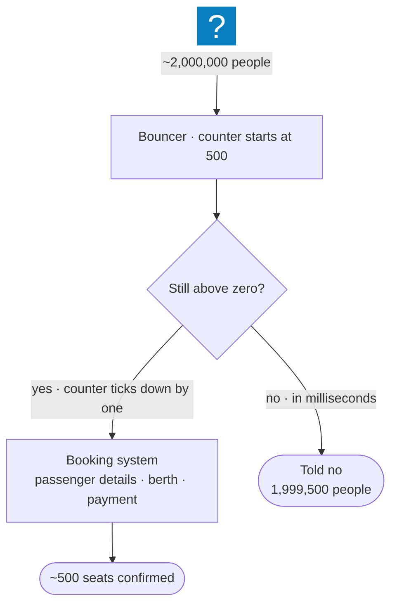
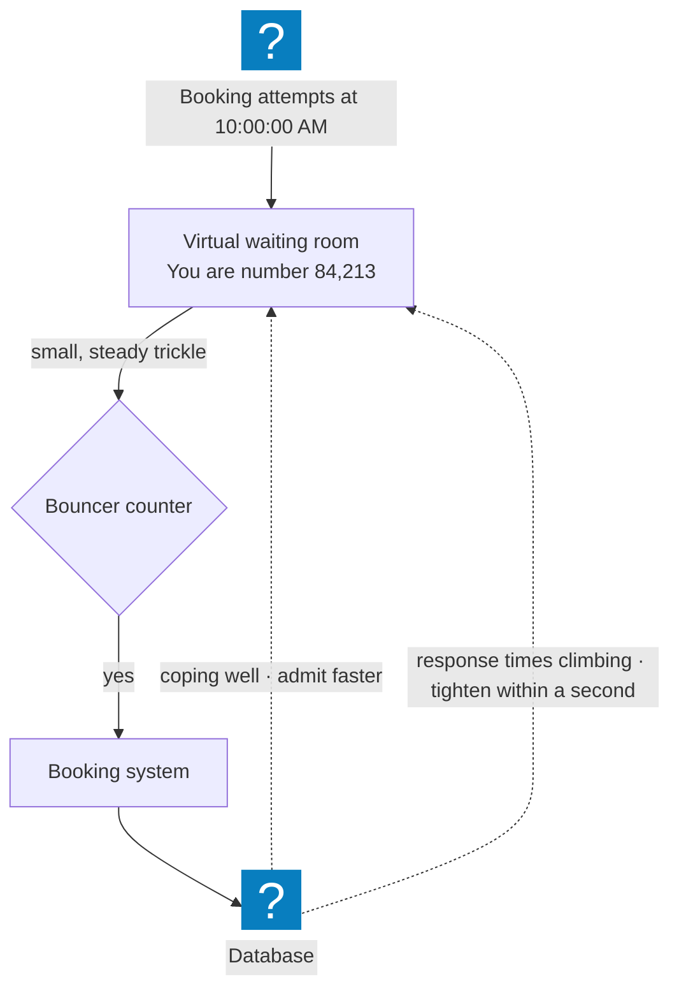
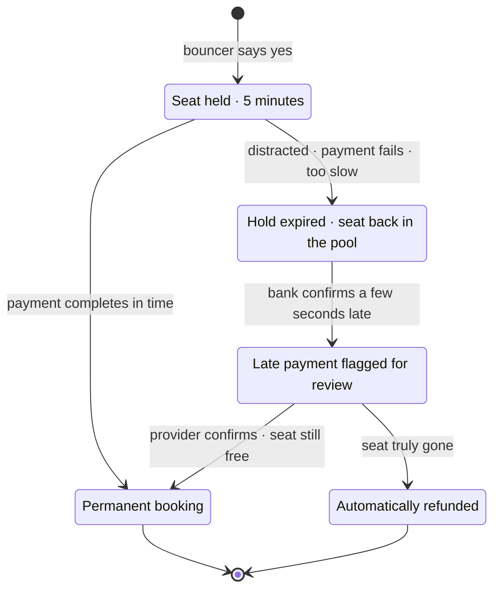
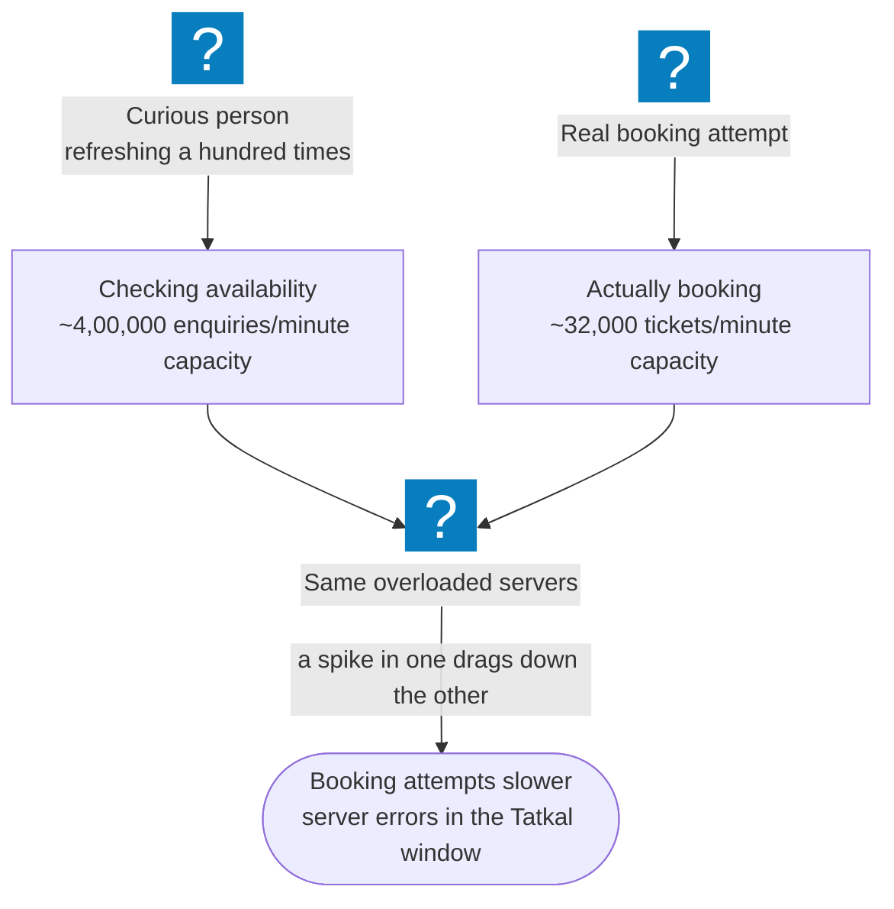

## Understanding the Problem: The Alarm That 2 Million People Set

Ananya's father called last night. Her grandmother is unwell in Lucknow, and the family needs her home by tomorrow evening. There's exactly one train that works — the one everyone in North India seems to want. Ananya sets two alarms: one for 9:55 AM, and one in her head that's been ticking since the phone call ended.

At 9:59 AM, she's not alone. Across the country, in college hostels, office cubicles, kitchens, and cyber cafés, roughly **two million other people** are opening the same app, refreshing the same page, staring at the same clock. They're all trying to do the exact same thing: grab one of a Tatkal quota that, on a popular train, might hold as few as **400 to 600 seats**.

At 10:00:00 AM, the clock ticks over. And in the time it takes you to read this sentence, most of those two million chances are already gone.

**The Numbers That Make This Insane:**
- **~2,000,000** people trying to book the same train, the same day
- **~500** actual seats available in that train's Tatkal quota
- **A 4,000-to-1** contest, decided in roughly **10 seconds**
- **99.975%** of everyone trying will fail — and they need to be told "no" *instantly*, not after waiting in a frozen loading screen
- One wrong move, and two real families show up at the same train door claiming the same berth

This happens every single day, on hundreds of trains, all over India. This is the story of the system standing at the door — and how it learned, sometimes the hard way, to say "no" fast, fairly, and without ever making a mistake that costs someone their seat or their money.


<!-- IMAGE PROMPT: A dramatic wide illustration of a giant funnel. At the top, a massive crowd of two million tiny human silhouettes (diverse Indian faces, different ages) all reaching upward toward a giant clock showing "10:00:00 AM". The funnel narrows dramatically downward. At the bottom, only a tiny cluster of exactly a few glowing golden train-ticket icons emerges, held by a handful of relieved-looking silhouettes, while a red "SOLD OUT" stamp appears just below them. Background hints at an Indian Railways station platform silhouette and a speeding train. Style: modern flat-illustration with a warm saffron-to-blue gradient, bold and slightly dramatic, like an infographic cover for a tech blog. Include small text labels "2,000,000 TRYING" at top and "500 SEATS" at the narrow bottom of the funnel. -->

---

## The Anatomy of a Tatkal Rush

To understand why this is so hard, you have to understand what Tatkal actually is. It's not regular booking. Indian Railways deliberately holds back a small block of seats on most trains — the **Tatkal quota** — and releases it **one day before the date of journey** (counted from the train's starting station), at a fixed clock time: **10:00 AM for AC classes, 11:00 AM for non-AC**.

It exists for exactly the situation Ananya is in: a sudden, urgent, can't-plan-ahead trip. And because everyone with an urgent trip converges on the same clock tick, Tatkal isn't really "ticket booking." It's closer to a nationwide, perfectly-synchronized sprint that happens 365 days a year.

Here's what makes one specific train the epicenter of the chaos: on ordinary days, Indian Railways' booking platform handles about **14.5 lakh (1.45 million) tickets a day**, spread across roughly **13,000 trains**. That's calm, predictable traffic. But a Tatkal quota on one *popular* route can pull in a wildly disproportionate share of attention — hundreds of thousands, sometimes over a million, hopeful clicks landing on one train's page in the same handful of seconds.

**Two Very Different Kinds of Traffic:**

| | Checking Availability | Actually Booking |
|---|---|---|
| Who does it | Almost everyone | The lucky few |
| Capacity (national, per minute, 2025) | ~4,00,000 enquiries/minute | ~32,000 tickets/minute |
| Ratio | **~12** | **1** |
| What happens if it's slow | Mildly annoying | Someone loses a real seat |

That roughly 12-to-1 ratio between the capacity built for looking and the capacity built for buying is the first clue to how this problem gets solved: the system that shows you *whether* a seat exists must be a completely different beast from the system that actually *hands you* one.

---

## Crisis Scenario: The 10 Seconds That Decide Everything

Let's slow down time and watch what actually happens at 10:00:00 AM.

```
09:59:58   Ananya's app is loaded. Her thumb is over the "Book Now" button.
09:59:59   So are 1,999,999 other thumbs across the country.
10:00:00   The clock ticks. Every single one of them presses at once.
10:00:01   The system receives what feels like an instantaneous tidal wave —
           hundreds of thousands of requests in the same second, all
           demanding the same 500 rows of data.
10:00:05   The popular train's Tatkal quota is already gone.
10:00:10   Millions of "Sorry, no tickets available" messages have gone out.
10:00:12   Ananya looks at her screen. It says "Booking Confirmed."
```

Indian Railways' actual, recorded numbers give a sense of scale here: the platform has clocked **37,410 tickets booked in a single minute** at its all-time peak (August 2025), and routinely sees **over 3 lakh (300,000+) concurrent users** during the 10 AM Tatkal rush. Some estimates suggest that between **8 lakh and 1 million people** attempt to even log in during that window, while only **3.3 to 3.5 lakh** actually make it through.

Here's the counter-intuitive part, the thing that trips up most people the first time they think about this problem: **this is not a storage problem.** Five hundred confirmed bookings take up a few hundred kilobytes of disk space — genuinely nothing. The entire challenge is that, for about ten seconds, five hundred tiny rows of data become the single most contested resource in the country's digital infrastructure. The hard part isn't holding the information. It's surviving the stampede to get near it.


<!-- IMAGE PROMPT: A dynamic split-frame illustration showing a giant analog clock face with the second hand sweeping from 9:59:55 to 10:00:10, rendered in a comic-panel style across 4 sequential frames left to right. Frame 1: calm crowd of phones/laptops glowing, all showing a countdown timer. Frame 2: the clock strikes 10:00:00, an explosive burst of lightning-bolt lines radiates outward from the clock center toward thousands of small device icons. Frame 3: a narrow glowing green gate with a small number of tickets passing through while red "X" marks appear on most incoming lines. Frame 4: the gate slams shut with a "SOLD OUT — 10:00:10 AM" banner, most devices now showing sad/red screens, a few showing a golden checkmark. Style: bold, energetic infographic illustration, saffron/green/blue Indian color palette, motion-blur lines to convey speed. -->

---

## Why This Is Harder Than It Looks: The Microphone Problem

Imagine a room with two million people, and in the middle of that room sits a single microphone with exactly 500 seconds of airtime left. Everyone wants to grab it, speak into it, and let go. Now imagine that the microphone itself has to somehow decide, fairly and instantly, who gets to hold it and for how long — while two million hands are grabbing at it simultaneously.

That's what a naive version of this system looks like. If you build it the "obvious" way — one database row for the seat count, updated every time someone tries to book — that single row becomes what engineers call a **hot key**: a piece of data so contested that it becomes the bottleneck for the *entire system*, not because the data is complicated, but because everyone wants to touch it at once.

The fix is surprisingly elegant once you see it: **separate "can I even try?" from "give me the seat."**

Picture a bouncer standing far outside the club, holding a small counter that starts at exactly 500. Every person who approaches gets one simple question answered — "is the counter still above zero?" — and the bouncer's counter ticks down by one for every "yes." This bouncer doesn't check IDs, doesn't collect payment, doesn't know anyone's name. All they do is one incredibly fast, incredibly simple job: say yes or no, instantly, to a firehose of people.

Only the roughly 500 people who get a "yes" ever reach the actual booking system inside — the one that checks passenger details, assigns a real berth, and takes payment. The other 1,999,500 people get told "no" by the bouncer, in milliseconds, without ever touching anything more delicate than a single number.



This is the secret that makes the whole system survivable: **the number of people you reject is unlimited, but the work of rejecting them must cost almost nothing.**

---

## The Virtual Waiting Room

Even a fast bouncer gets trampled if two million people rush the door at the exact same instant. So there's a layer even *before* the bouncer: a **virtual waiting room**.

Here's how it actually feels from the user's side: the moment you try to book, instead of hanging on a spinning wheel, you're handed a queue ticket — something like *"You are number 84,213. Estimated wait: a few seconds."* You're not stuck; you're not lied to. You're told the truth, instantly, and then let through in a small, steady trickle that the booking system behind the scenes can actually handle.

What makes this waiting room smart, rather than just a glorified queue, is that it **breathes** with the system's real-time health:

- If the database is coping well, it opens the doors a little wider and admits people faster.
- The moment response times start climbing even slightly, it tightens the flow — automatically, within a second — long before anything actually breaks.
- It intentionally does **not** simply let in whoever clicked fastest. That would just reward whoever's script or connection is quickest, not whoever's need is most genuine — which matters a lot once you consider that some of those two million "people" aren't people at all (more on that shortly).

This single idea — a smart front door that adapts to the crowd, instead of a system that just gets crushed by it — is the difference between "IRCTC is down again" and "IRCTC handled it."




<!-- IMAGE PROMPT: A serene yet clever illustration of a modern digital "waiting room" concept. Show a glowing turnstile/gate icon in the center with a small display reading "Position: 84,213 — Est. wait: 2 sec". Behind the gate, a calm, orderly queue of glowing human silhouette icons stretches back and fades into a soft blur (representing millions), while a small trickle of 3-4 silhouettes passes smoothly through the open gate into a bright green "Booking Hall" area on the right. A subtle dashboard-style gauge above the gate shows "System Health: Optimal" with a needle in the green zone. Style: clean, modern, minimal UI-inspired illustration, calming blue and teal palette with warm golden accents on the admitted figures, conveying order emerging from chaos. -->

---

## Hold First, Charge Later

Say Ananya makes it through the waiting room and the bouncer says yes. She's not holding a ticket yet — she's holding a **chance**. She still has to pick her berth, type in passenger details, verify an OTP, and pay. That takes real time: seconds, sometimes a couple of minutes if her hands are shaking a little from the adrenaline.

During that window, the system does something clever: it puts a **temporary hold** on that one seat — invisible to everyone else, locked just for her, for exactly **five minutes**. If she completes payment in time, the hold becomes a real, permanent booking. If she gets distracted, her payment fails, or she simply takes too long, the hold **automatically expires and the seat goes right back into the pool** — instantly available to the next person in line.

This "hold, then confirm" pattern solves a problem you might not expect: what happens if her bank confirms the payment a few seconds *after* her hold has already expired? The system doesn't guess. It doesn't panic. It quietly flags that transaction for review, checks the real outcome with the payment provider, and resolves it cleanly — either the booking goes through after all, or, if the seat is truly gone, her money is **automatically refunded**, no support ticket required.



That last part matters more than it sounds. In a system moving this fast, the one rule that can never, ever bend is: **money and seats must always match up, exactly, for every single person, every single time.**

---

## The War Against Bots

Here's the part of this story that isn't really about engineering at all — it's about human (and inhuman) behavior.

Every seat a script grabs in the opening seconds is a seat a real, urgent traveler never gets to see. And for years, that's exactly what happened at scale: automated scripts that fill forms faster than any human, and organized touts who'd snap up Tatkal seats in bulk within seconds to resell them at a markup — a genuinely illegal practice in India, and a deeply frustrating one for ordinary passengers.

The 2025 numbers on this are staggering. Indian Railways disclosed that it **deactivated about 3.03 crore (30.3 million) suspicious user accounts**, put crores more under suspension or revalidation that year, blocked nearly **13,000 suspicious email domains**, and reported around **4 lakh (400,000) suspicious PNRs** on the National Cyber Crime Reporting Portal. This isn't a hypothetical threat model — it's a daily, industrial-scale fight.

The response, rolled out through 2025, reads like a layered defense:

- **Aadhaar-based identity verification** became mandatory for Tatkal bookings on the website and app starting **1 July 2025**.
- **Aadhaar-linked OTP authentication** became mandatory — for web, app, *and* counter/agent bookings — from **15 July 2025**.
- **Authorized travel agents were banned from booking in the first 30 minutes** of the Tatkal window (10:00–10:30 AM for AC classes), specifically to give individual travelers a fair shot at the seats that matter most: the very first ones released.
- Behind the scenes, the system watches for tells that no human typing on a phone would produce: forms submitted in under a second, dozens of "different" accounts all logging in from the same device, requests pouring in from data-center IP ranges rather than actual homes or mobile networks.

None of these are silver bullets on their own. Together, they raise the cost of cheating high enough that most of it simply isn't worth attempting anymore — which, in security, is often the most realistic version of "winning."


<!-- IMAGE PROMPT: A visually striking split-screen illustration. Left side: a shadowy robotic hand/script icon (green matrix-style code streaming from its fingers) rapidly clicking a booking button, surrounded by multiple identical duplicate ghost-icons representing fake accounts, all trying to pass through a gate. Right side: the same gate now has a glowing shield icon with an Aadhaar-style fingerprint/OTP symbol on it, blocking the robotic hand with a red barrier, while a genuine warm-toned human hand (holding a phone with an OTP screen) passes through smoothly with a green checkmark. Include small icons around the shield: a clock icon (time-window restriction), a fingerprint icon (Aadhaar), and a speedometer icon (velocity check). Style: modern cybersecurity-meets-civic-tech illustration, cool blues and greens for the "defense" side, ominous dark green/black for the "bot" side. -->

---

## When It All Goes Wrong: Real War Stories

No system this contested gets everything right on the first try, and IRCTC's own history proves it.

**December 2024**, a Tatkal morning like any other: complaints started flooding social media and outage-tracking sites around 10 AM, right as the Tatkal window opened. Users trying to book were met with a message that must rank among the most painful sentences in Indian tech: *"Due to maintenance activity, e-ticketing service will not be available for the next one hour. Please try later."* On a Tatkal morning, "try later" isn't advice — it's a door slamming shut on someone's train.

**October 2025**, in the run-up to Diwali and Chhath Puja — the biggest travel season of the year — server errors returned during the Tatkal window yet again (17 October), echoing the string of December 2024 failures. Passengers, understandably, asked the obvious question: why does this keep happening during the exact minutes when it matters most?

The recurring lesson across these incidents is almost always the same one: when the system that lets people *check* availability shares infrastructure with the system that lets people *book*, a spike in one drags down the other. A curious person refreshing the availability page a hundred times shouldn't be able to make a real booking attempt any slower — but if both are running on the same overloaded servers, that's exactly what happens.



It's a humbling reminder that even a platform processing over a million tickets a day, with genuinely sophisticated engineering behind it, is still fighting an ongoing battle against its own popularity — and against a clock that refuses to give it any warm-up time.

---

## Lessons for Any Engineer

You don't need to work on a national railway system to run into a smaller version of this problem. Flash sales, concert ticket drops, exam registration portals, government subsidy schemes with limited slots — they're all the same shape: **too many people, too little inventory, too short a window.**

A few things this story makes clear, regardless of what you're building:

- **Storage is rarely your bottleneck in a rush like this — traffic shape is.** Five hundred rows of data were never the hard part; surviving the stampede to reach them was.
- **Separate the "looking" traffic from the "buying" traffic**, physically if you can. They have completely different tolerances for staleness and completely different consequences for failure.
- **Reject fast, reject cheap, and reject honestly.** A system that can instantly say "you're #84,213, here's your honest wait" builds more trust than one that hangs silently and times out.
- **"Hold, then confirm" beats "grab and hope"** for anything involving both inventory and payment — always give yourself a clean, automatic way to undo a half-finished transaction.
- **Assume some of your traffic isn't human**, and design your defenses in layers — identity, timing, and behavior — rather than betting everything on one clever trick.

---

## Summary: The Ten Seconds That Matter Most

Ananya's booking confirmation arrives at 10:00:12 AM. Twelve seconds. Somewhere in a data center, a small in-memory counter ticked down from 500 to 499, and stayed honest through a wave of two million simultaneous requests that could easily have broken it.

She books her seat home to see her grandmother. A few hundred kilometers away, someone else refreshes their screen one more time, sees "Sold Out," and starts looking at the waitlist instead — disappointed, but not double-charged, not stuck in limbo, not lied to about what happened.

That, in the end, is the real achievement here. Not that the system is unbreakable — history shows it isn't, not always. But that on most days, for most people, in a country of over a billion, a system built to handle an almost absurd amount of simultaneous hope manages to say "yes" to exactly the right five hundred people, and an honest, instant "no" to everyone else.

The next time you're refreshing a page at exactly 10:00:00 AM, hoping to be one of the lucky few — somewhere behind that spinning loader, a very small, very fast counter is quietly doing the hardest job in the building.

---

*Have you ever been one of the lucky few in a Tatkal rush — or one of the millions who weren't? The system behind that ten-second window is a small masterpiece of engineering under pressure, built one hard lesson at a time.*
