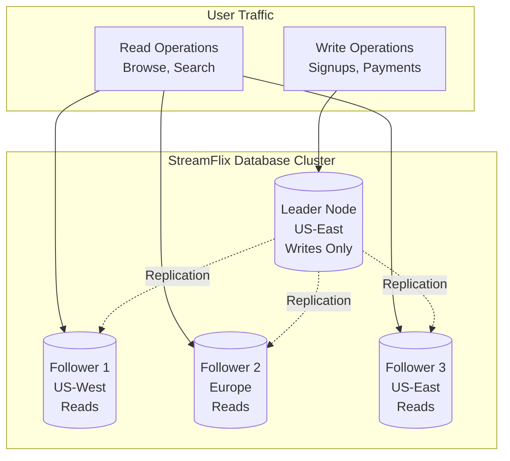
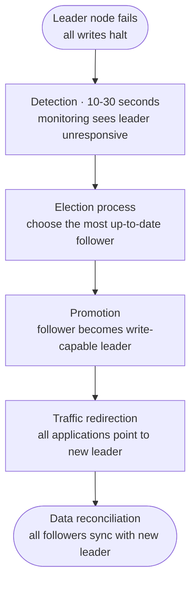
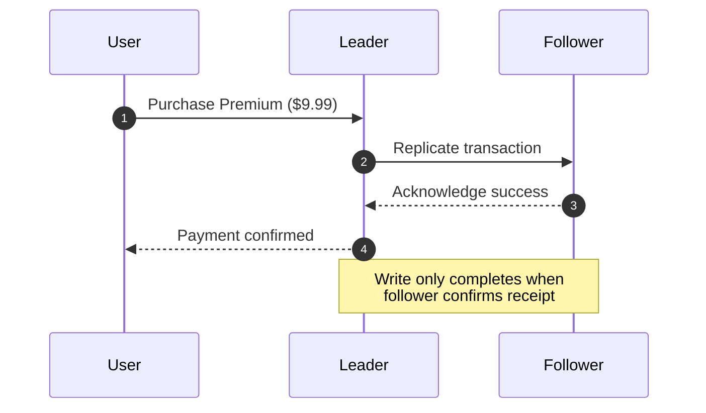
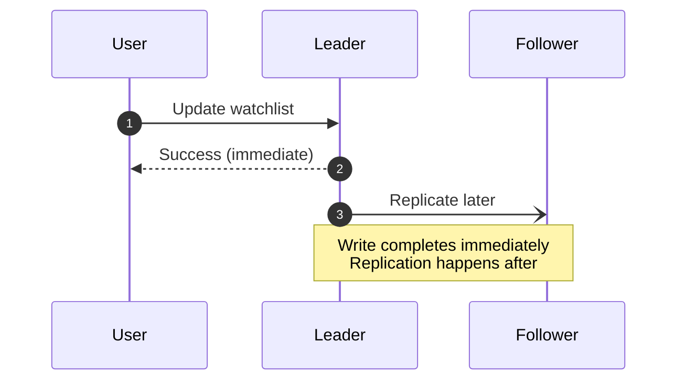
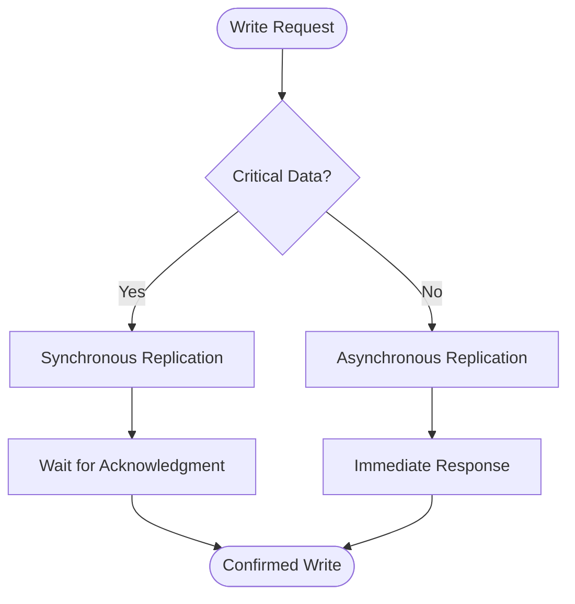
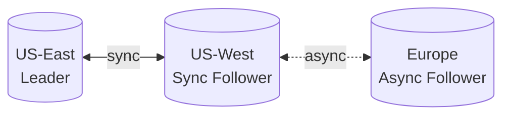

## Understanding the Problem: When Database Nodes Go Dark

Imagine you're running **StreamFlix**, a popular video streaming platform serving millions of users globally. Your database powers everything from user authentication to movie recommendations, using a **leader-follower replication** setup for scalability and reliability.

At 2 AM on Black Friday, disaster strikes. Your primary database server in the US-East data center suddenly becomes unresponsive during peak traffic. Millions of users can't log in, stream videos, or access their watchlists. Every second of downtime costs thousands in revenue and user trust.

**Our Mission:** Design a bulletproof leader-follower replication system that gracefully handles node failures while maintaining data consistency and minimal downtime.

---

## The Anatomy of Our Streaming Platform

**StreamFlix's Database Architecture:**
- **Leader Node** (Primary): Handles all writes - user signups, viewing history, payment processing
- **3 Follower Nodes** (Replicas): Serve read queries - movie catalogs, user profiles, recommendations
- **Global Distribution**: Nodes spread across US-East, US-West, and Europe for low latency



---

## Crisis Scenarios: When Things Go Wrong

### Scenario 1: Follower Node Crash (The Minor Emergency)

**The Incident:** During a popular series finale, Follower 2 (Europe) crashes due to hardware failure. European users start experiencing slower response times.

**What Happens:**
- **Writes Continue Unaffected** → New user signups and payment processing remain smooth
- **Read Traffic Redistributes** → Load balancer redirects European users to other followers
- **Replication Queues Build Up** → Leader stores pending changes for the crashed follower

**Detection & Recovery:**
```
Monitoring Alert: "Follower-EU heartbeat missed - 3 consecutive failures"
Auto-Recovery: Redirect traffic → Restart node → Sync from WAL logs
Recovery Time: 2-5 minutes for full synchronization
```

### Scenario 2: Leader Node Failure (The Major Crisis)

**The Incident:** Our leader node suffers a catastrophic failure during peak Black Friday traffic. The entire write pipeline is down.

**Immediate Impact:**
- ❌ **All Writes Halt** → Users can't sign up, purchase, or update profiles
- ⚠️ **Read Inconsistency Risk** → Followers may have stale data
- 🔄 **Failover Required** → Must promote a follower to leader

**The Failover Dance:**
1. **Detection** (10-30 seconds) → Monitoring detects leader unresponsiveness
2. **Election Process** → Choose the most up-to-date follower as new leader
3. **Promotion** → Selected follower becomes the new write-capable leader
4. **Traffic Redirection** → All applications point to the new leader
5. **Data Reconciliation** → Ensure all followers sync with new leader



---

## The Consistency Challenge: Synchronous vs Asynchronous Replication

### The StreamFlix Dilemma

**Payment Processing** (Critical): When a user purchases a premium subscription, we **cannot** lose this transaction data. Missing a payment means lost revenue and angry customers.

**Viewing History** (Less Critical): If a user's "continue watching" position is slightly behind, it's annoying but not catastrophic.

### Two Replication Strategies

#### Synchronous Replication: The Safe but Slower Approach


**StreamFlix Use Case:** Payment processing, subscription changes
- ✅ **Zero Data Loss** → If leader fails, follower has all transactions
- ❌ **Higher Latency** → Each write waits for follower acknowledgment
- ❌ **Availability Risk** → Slow followers can block all writes

#### Asynchronous Replication: The Fast but Risky Approach


**StreamFlix Use Case:** Viewing history, recommendations, user preferences
- ✅ **High Performance** → Writes complete immediately
- ✅ **Better Availability** → Slow followers don't block operations
- ❌ **Potential Data Loss** → Recent changes may be lost if leader fails

---

## Real-World Battle Stories: How Giants Handle Failures

### PostgreSQL: The Manual Hero

**StreamFlix's Payment Database Setup:**
```
# PostgreSQL Streaming Replication Configuration
# postgresql.conf (Leader)
wal_level = replica
max_wal_senders = 3
synchronous_commit = on
synchronous_standby_names = 'payment_replica'

# postgresql.conf + empty standby.signal file (Follower, PostgreSQL 12+)
primary_conninfo = 'host=leader-db port=5432 application_name=payment_replica'
```

**Failure Scenario:** Leader crashes during payment processing
- **Detection:** Connection timeouts after 30 seconds
- **Recovery:** Manual promotion (`pg_ctl promote`), or automatic failover with tools like **Patroni**
- **Downtime:** 2-5 minutes for manual failover
- **Data Safety:** Synchronous mode ensures zero payment data loss, as long as the synchronous standby is the one promoted

### MongoDB: The Automatic Guardian

**StreamFlix's User Data Setup:**
```
// MongoDB Replica Set Configuration
rs.initiate({
  _id: "streamflix-users",
  members: [
    { _id: 0, host: "leader.db:27017", priority: 2 },
    { _id: 1, host: "follower1.db:27017", priority: 1 },
    { _id: 2, host: "follower2.db:27017", priority: 1 }
  ]
})
```

**Failure Scenario:** Primary node becomes unreachable
- **Detection:** Heartbeat failure within 10 seconds
- **Recovery:** Automatic election and promotion
- **Downtime:** 10-30 seconds for automatic failover
- **Consistency:** Write concern majority ensures data safety

---

## The Complete Disaster Recovery Playbook

### Phase 1: Preparation (Before Disaster Strikes)
```
# Monitoring Setup
alerts:
  - replication_lag > 5_seconds
  - node_heartbeat_failed > 3_attempts
  - disk_space < 10%
  
# Backup Strategy
full_backup: daily
incremental_backup: hourly
cross_region_backup: enabled
```

### Phase 2: Detection (First 30 Seconds)
- Automated health checks every 2-10 seconds
- Multiple detection methods: heartbeats, connection tests, query timeouts
- Alert escalation to on-call engineers

### Phase 3: Response (Next 2-5 Minutes)
- **Follower Failure:** Redirect traffic, attempt restart, rebuild if needed
- **Leader Failure:** Execute failover procedure, promote best follower
- **Split-Brain Prevention:** Fence old leader to prevent dual-writer scenarios

### Phase 4: Recovery (Next 10-30 Minutes)
- Verify new topology is stable
- Resync failed nodes from backups or WAL logs
- Update application configurations
- Post-incident analysis and improvements

---

## Advanced Patterns for Mission-Critical Systems

### The Hybrid Approach: Best of Both Worlds



**StreamFlix Implementation:**
- **Payments, Subscriptions** → Synchronous (can't lose money!)
- **Viewing History, Preferences** → Asynchronous (performance matters)
- **User Authentication** → Semi-synchronous (balance of both)

### Geographic Distribution Strategy



- **Regional Writes** → Synchronous to nearby follower
- **Cross-Ocean** → Asynchronous to handle network latency
- **Disaster Recovery** → Each region can promote local follower

---

## Measuring Success: Key Metrics That Matter

| Metric | Target | Why It Matters |
|--------|--------|----------------|
| **RTO (Recovery Time Objective)** | < 5 minutes | How quickly service restores after failure |
| **RPO (Recovery Point Objective)** | < 30 seconds | Maximum acceptable data loss |
| **Replication Lag** | < 1 second | How far behind followers are |
| **Failover Success Rate** | > 99.9% | Reliability of automatic promotion |
| **False Positive Alerts** | < 5% | Quality of monitoring system |

---

## Common Pitfalls and War Stories

### The Split-Brain Disaster
**What Happened:** Network partition made both leader and promoted follower think they were primary
**Result:** Conflicting writes, data corruption, 4-hour recovery time
**Prevention:** Implement proper fencing and witness nodes

### The Cascading Failure
**What Happened:** Follower failure increased load on remaining nodes, causing them to fail too
**Result:** Complete cluster outage during peak traffic
**Prevention:** Proper capacity planning and circuit breakers

### The Backup That Wasn't
**What Happened:** Discovered during recovery that backups were corrupted for 2 weeks
**Result:** Massive data loss, customer lawsuits
**Prevention:** Regular backup testing and multiple redundant copies


---

## Summary: Building Antifragile Database Systems

Leader-follower replication isn't just about copying data—it's about **engineering resilience** into the heart of your application. By understanding the trade-offs between consistency and availability, implementing proper monitoring and failover procedures, and learning from real-world battle stories, we can build systems that don't just survive disasters—they thrive through them.

**Key Takeaways:**
- **Design for Failure** → Assume nodes will fail, plan accordingly
- **Monitor Everything** → What you can't measure, you can't improve
- **Test Regularly** → Practice failover procedures before you need them
- **Balance Trade-offs** → Choose sync vs async based on data criticality
- **Learn from Others** → PostgreSQL and MongoDB have solved these problems at scale

The next time disaster strikes your database cluster, you'll be ready with battle-tested strategies that keep your users streaming, your payments processing, and your business running smoothly.
---
