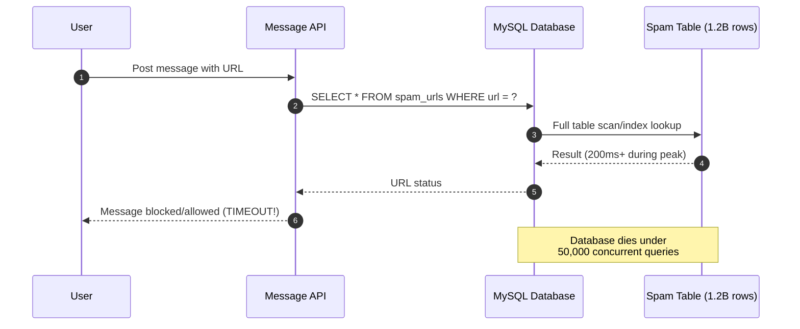
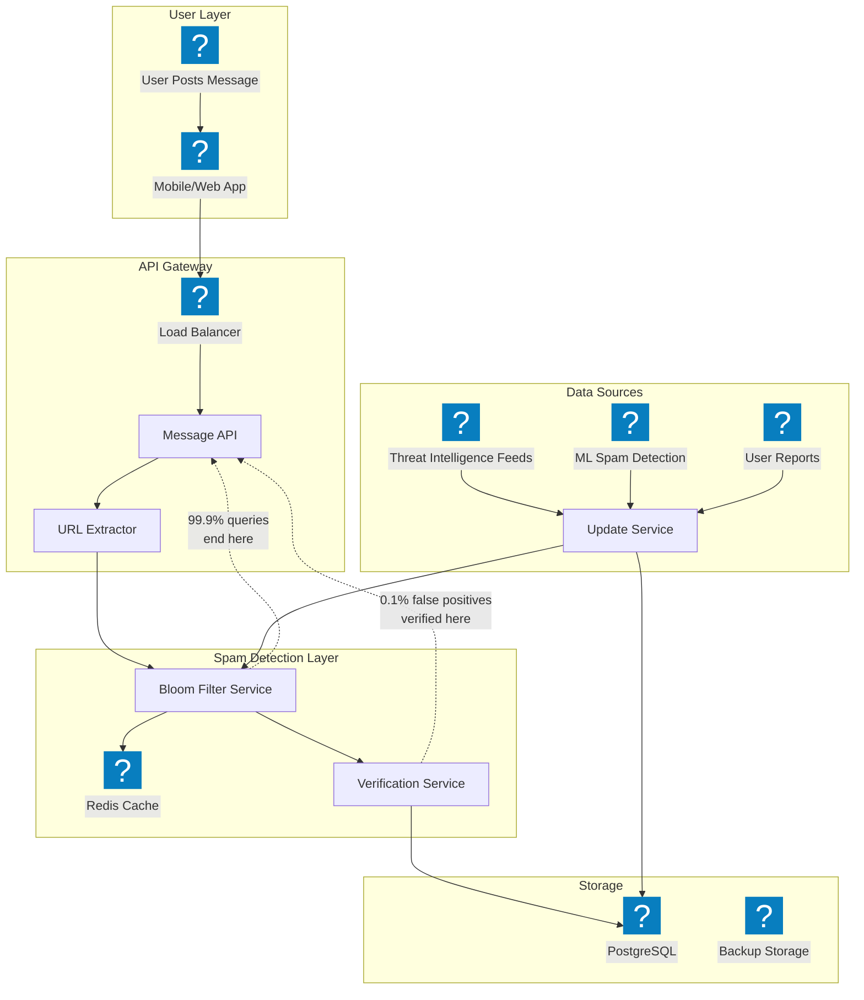
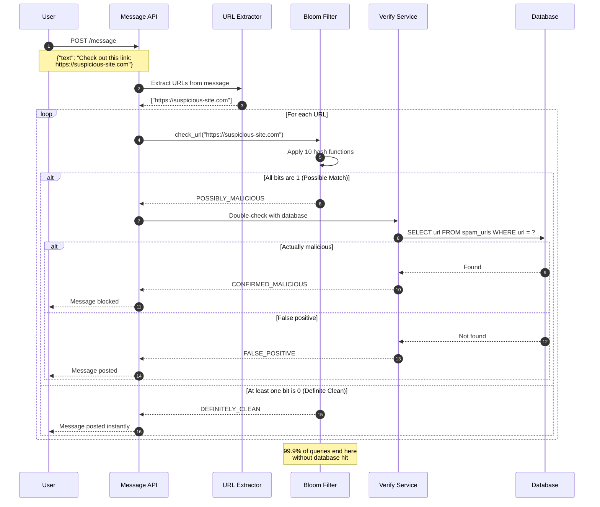
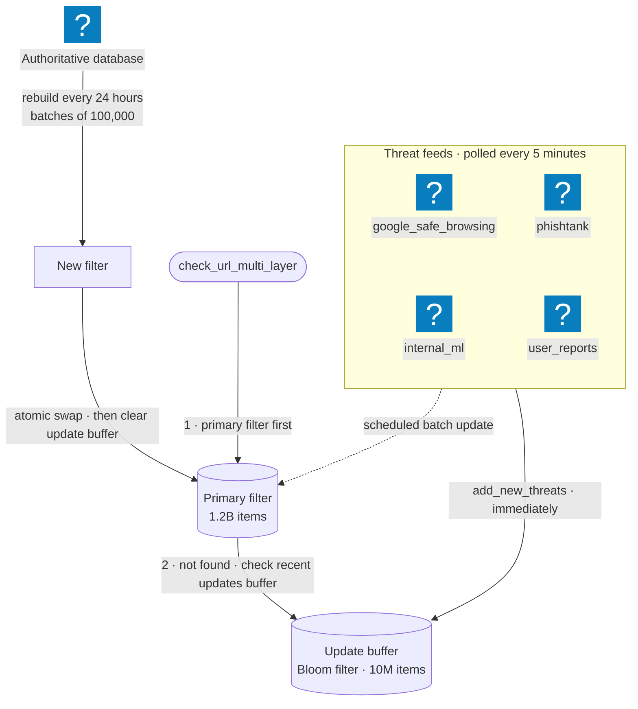
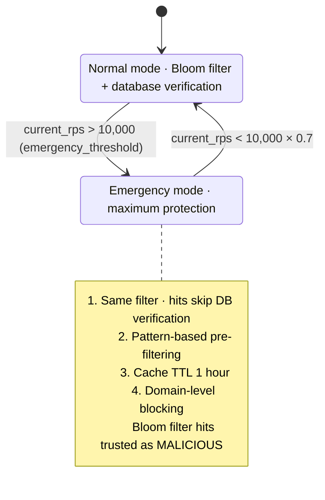

## Understanding the Problem: The Battle Against Digital Deception

Meet **Sarah**, a content moderator at **GlobalForum**, the world's largest discussion platform with 500 million active users. Every second, hundreds of messages flood the platform—some containing innocent links to news articles, others harboring malicious phishing scams designed to steal user credentials or spread malware.

At 3 AM during a major geopolitical event, GlobalForum experiences a **10x traffic spike**. Malicious actors exploit the chaos, flooding the platform with fake news sites, cryptocurrency scams, and phishing links disguised as legitimate sources. Sarah watches helplessly as the traditional database-backed spam detection system **collapses under load**, allowing thousands of malicious URLs to slip through while legitimate users face frustrating delays.

**The Crisis Numbers:**
- **200 million URL checks per day** during normal traffic
- **2 billion checks per day** during major news events (10x)
- **Target latency: <50ms** for message submission
- **1.2 billion known malicious URLs** constantly updated from threat feeds
- **5 million new spam URLs added hourly** during attacks

**Our Mission:** Design a lightning-fast spam detection system that can handle billions of checks per day without breaking the bank or slowing down users, while ensuring **zero false negatives**—no *known* malicious URL must ever slip through.

---

## The Scale of Digital Deception

**GlobalForum's Spam Challenge:**
```
Daily Statistics:
├── 500M active users
├── 50M messages posted daily
├── 200M URLs submitted for checking
├── 1.2B known malicious URLs in database
├── 3.6M+ new threats added daily (up to 5M hourly during attacks)
└── <50ms response time requirement

Peak Event Traffic (Breaking News):
├── 10x message volume spike
├── ~330M URL checks in 4 hours (10x rate)
├── ~23,000 requests per second, bursting to 50,000
├── Coordinated spam campaigns
└── System must NOT fail
```

### Traditional Database Approach: Why It Fails



**Why Traditional Databases Fail:**
- **Memory Exhaustion**: 1.2B URLs × 100 bytes average = 120GB+ RAM required
- **Query Bottleneck**: Even with indexes, billions of lookups overwhelm connections
- **Update Conflicts**: Millions of hourly insertions block read queries
- **Scaling Costs**: Adding database replicas costs $10,000+ monthly per instance

---

## The Set Membership Problem: A Different Perspective

The spam detection challenge is fundamentally a **set membership problem**:

> *"Given a massive set S of malicious URLs, and a query URL q, determine if q ∈ S in constant time with minimal memory usage."*

Traditional approaches:
- **Hash Set**: Perfect accuracy, but 120GB+ memory requirement
- **Database Index**: Fast for small sets, but query latency increases with scale
- **Caching**: Limited effectiveness due to long-tail URL distribution

**What we need:** A data structure that can answer "Is this URL malicious?" in **O(1) time** with **predictable memory usage**, accepting some trade-offs in accuracy.

---

## Enter Bloom Filters: The Probabilistic Guardian

### What is a Bloom Filter?

A **Bloom filter** is a space-efficient probabilistic data structure designed for ultra-fast set membership tests. Think of it as a "smart summary" of your data that can definitively say "NO, this item is NOT in the set" but can sometimes give false positives saying "MAYBE, this item IS in the set."

**The Core Promise:**
- ✅ **No False Negatives**: If Bloom filter says "not present," it's **guaranteed safe**
- ⚠️ **Some False Positives**: If it says "possibly present," needs verification (tunable rate)
- ⚡ **O(1) Performance**: Constant time regardless of data set size
- 💾 **Memory Efficient**: 10-15 bits per item vs. ~800 bits (100 bytes) for full storage

### How Bloom Filters Work: The Binary Magic

```
Step 1: Initialize Bit Array (16 bits for example)
index:   0 1 2 3 4 5 6 7 8 9 0 1 2 3 4 5   (positions 0-15, last digit shown)
Bits:   [0 0 0 0 0 0 0 0 0 0 0 0 0 0 0 0]

Step 2: Choose Hash Functions
- hash1(x) = x % 16
- hash2(x) = (x * 7) % 16  
- hash3(x) = (x * 13) % 16

Step 3: Insert "evil-phishing-site.com"
URL Hash: 42
- hash1(42) = 42 % 16 = 10
- hash2(42) = (42 * 7) % 16 = 6
- hash3(42) = (42 * 13) % 16 = 2

Set bits 2, 6, 10:
Bits:   [0 0 1 0 0 0 1 0 0 0 1 0 0 0 0 0]
             ↑       ↑       ↑

Step 4: Query "suspicious-crypto.net"  
URL Hash: 29
- hash1(29) = 29 % 16 = 13
- hash2(29) = (29 * 7) % 16 = 11
- hash3(29) = (29 * 13) % 16 = 9

Check bits at positions 13, 11, 9:
Bits:   [0 0 1 0 0 0 1 0 0 0 1 0 0 0 0 0]
                           ↑   ↑   ↑
         pos9, 11, 13 = 0, 0, 0

Result: "DEFINITELY NOT MALICIOUS" (at least one bit is 0)
```

### Bloom Filter Mathematics: Tuning for Perfection

**Key Parameters:**
- `n` = number of items (malicious URLs)
- `m` = size of bit array  
- `k` = number of hash functions
- `p` = false positive probability

**Optimal Formulas:**
```
m = -n × ln(p) / (ln(2)²)    # Required bits
k = (m/n) × ln(2)            # Optimal hash functions
p = (1 - e^(-kn/m))^k        # Actual false positive rate
```

**GlobalForum's Configuration:**
```
Requirements:
- n = 1.2 billion malicious URLs
- p = 0.1% false positive rate (1 in 1000)

Calculations:
- m = -1.2B × ln(0.001) / (ln(2)²) ≈ 17.2 billion bits ≈ 2.15 GB
- k = (17.2B/1.2B) × ln(2) ≈ 10 hash functions

Result: 2.15GB memory vs. 120GB+ for full URL storage!
```

---

## System Architecture: Bloom Filter-Powered Spam Detection

### Core Architecture Overview



### The Complete Flow: From URL to Decision



---

## Implementation Deep Dive: Building the Bloom Filter Service

### Core Bloom Filter Implementation

```
import hashlib
import mmh3  # MurmurHash3 for better distribution
import redis
import numpy as np
from typing import List, Set

class ScalableBloomFilter:
    def __init__(self, expected_items: int = 1_200_000_000, false_positive_rate: float = 0.001,
                 key: str = "spam_bloom_filter"):
        """Initialize Bloom filter optimized for URL spam detection"""
        
        # Calculate optimal parameters
        self.expected_items = expected_items
        self.false_positive_rate = false_positive_rate
        
        # Optimal bit array size
        self.bit_size = int(-expected_items * np.log(false_positive_rate) / (np.log(2) ** 2))
        
        # Optimal number of hash functions  
        self.hash_count = round((self.bit_size / expected_items) * np.log(2))  # 9.97 -> 10 (int() would give 9)
        
        # Initialize bit array (distributed across Redis)
        # Each filter needs its OWN key; one Redis string holds at most 2^32 bits
        # (512 MB), so the 17.2B-bit array is split across 5 keys
        self.redis_client = redis.Redis(host='redis-cluster', port=6379)
        self.bit_array_key = key
        self.max_bits_per_key = 2 ** 32
        
        print(f"Bloom Filter Config:")
        print(f"  Expected items: {expected_items:,}")
        print(f"  False positive rate: {false_positive_rate}")
        print(f"  Bit array size: {self.bit_size:,} bits ({self.bit_size/8/1024/1024:.1f} MB)")
        print(f"  Hash functions: {self.hash_count}")
        
    def _hash_functions(self, url: str) -> List[int]:
        """Generate multiple hash values for URL"""
        
        # Normalize URL for consistent hashing
        normalized_url = self._normalize_url(url)
        
        hash_values = []
        
        # Use different hash algorithms for independence
        base_hashes = [
            int(hashlib.md5(normalized_url.encode()).hexdigest(), 16),
            int(hashlib.sha1(normalized_url.encode()).hexdigest(), 16),
            mmh3.hash(normalized_url, seed=42),
            mmh3.hash(normalized_url, seed=123),
        ]
        
        # Generate required number of hash functions using double hashing
        for i in range(self.hash_count):
            if i < len(base_hashes):
                hash_val = base_hashes[i] % self.bit_size
            else:
                # Double hashing: h1(x) + i*h2(x)
                hash_val = (base_hashes[0] + i * base_hashes[1]) % self.bit_size
            
            hash_values.append(hash_val)
        
        return hash_values
    
    def _normalize_url(self, url: str) -> str:
        """Normalize URL to catch variations of same malicious site"""
        
        # Remove protocol
        url = url.lower().replace('https://', '').replace('http://', '')
        
        # Remove www prefix
        if url.startswith('www.'):
            url = url[4:]
        
        # Remove trailing slash
        url = url.rstrip('/')
        
        # Remove common tracking parameters
        tracking_params = ['utm_source', 'utm_medium', 'utm_campaign', 'fbclid', 'gclid']
        if '?' in url:
            base_url, params = url.split('?', 1)
            param_list = params.split('&')
            filtered_params = [p for p in param_list if not any(p.startswith(tp) for tp in tracking_params)]
            
            if filtered_params:
                url = base_url + '?' + '&'.join(filtered_params)
            else:
                url = base_url
        
        return url
    
    def _locate(self, position: int):
        """Map a global bit position to (Redis key, offset within that key)"""
        shard, offset = divmod(position, self.max_bits_per_key)
        return f"{self.bit_array_key}:{shard}", offset
    
    def add_url(self, url: str) -> None:
        """Add malicious URL to Bloom filter"""
        
        hash_positions = self._hash_functions(url)
        
        # Set bits in Redis using pipeline for performance
        pipe = self.redis_client.pipeline()
        for position in hash_positions:
            pipe.setbit(*self._locate(position), 1)
        pipe.execute()
    
    def bulk_add_urls(self, urls: List[str]) -> None:
        """Efficiently add many URLs at once"""
        
        pipe = self.redis_client.pipeline()
        
        for url in urls:
            hash_positions = self._hash_functions(url)
            for position in hash_positions:
                pipe.setbit(*self._locate(position), 1)
        
        # Execute all operations in single batch
        pipe.execute()
    
    def check_url(self, url: str) -> bool:
        """Check if URL might be malicious (fast O(1) operation)"""
        
        hash_positions = self._hash_functions(url)
        
        # Check all required bits using pipeline
        pipe = self.redis_client.pipeline()
        for position in hash_positions:
            pipe.getbit(*self._locate(position))
        
        results = pipe.execute()
        
        # URL is possibly malicious only if ALL bits are set
        return all(bit == 1 for bit in results)
    
    def get_stats(self) -> dict:
        """Get Bloom filter statistics"""
        
        # Count set bits (expensive operation, use sparingly)
        set_bits = 0
        bit_sample_size = min(10000, self.bit_size)  # Sample for estimation
        step = self.bit_size // bit_sample_size
        
        for i in range(0, self.bit_size, step):  # sample across the WHOLE array
            if self.redis_client.getbit(*self._locate(i)):
                set_bits += 1
        
        # Estimate total set bits
        estimated_set_bits = set_bits * step
        load_factor = estimated_set_bits / self.bit_size  # fraction of bits set
        
        # Estimate actual false positive rate: all k probed bits happen to be set
        actual_fp_rate = load_factor ** self.hash_count
        
        return {
            'bit_size': self.bit_size,
            'hash_count': self.hash_count,
            'estimated_set_bits': estimated_set_bits,
            'load_factor': load_factor,
            'target_fp_rate': self.false_positive_rate,
            'actual_fp_rate': actual_fp_rate,
            'memory_usage_mb': self.bit_size / 8 / 1024 / 1024
        }

# Initialize GlobalForum's spam detection
spam_filter = ScalableBloomFilter(
    expected_items=1_200_000_000,
    false_positive_rate=0.001
)
```

### High-Performance URL Checking Service

```
import asyncio
import aioredis
from fastapi import FastAPI, HTTPException
from pydantic import BaseModel
from typing import List
import time

app = FastAPI(title="Spam URL Detection Service")
service = None  # created once at startup (below), shared by all requests

class URLCheckRequest(BaseModel):
    urls: List[str]
    
class URLCheckResponse(BaseModel):
    results: List[dict]
    processing_time_ms: float

class SpamDetectionService:
    def __init__(self):
        self.bloom_filter = ScalableBloomFilter()
        self.verification_cache = {}
        self.stats = {
            'total_checks': 0,
            'bloom_hits': 0,
            'verified_malicious': 0,
            'false_positives': 0
        }
    
    async def check_urls_batch(self, urls: List[str]) -> List[dict]:
        """Check multiple URLs efficiently"""
        
        start_time = time.time()
        results = []
        
        # Stage 1: Bloom filter check (ultra-fast)
        bloom_results = []
        for url in urls:
            is_possibly_malicious = self.bloom_filter.check_url(url)
            bloom_results.append({
                'url': url,
                'bloom_result': is_possibly_malicious
            })
            
            self.stats['total_checks'] += 1
            if is_possibly_malicious:
                self.stats['bloom_hits'] += 1
        
        # Stage 2: Verify potential matches (slower, but rare)
        for result in bloom_results:
            if result['bloom_result']:
                # Check cache first
                if result['url'] in self.verification_cache:
                    is_actually_malicious = self.verification_cache[result['url']]
                else:
                    # Database verification (only for ~0.1% of URLs)
                    is_actually_malicious = await self._verify_with_database(result['url'])
                    self.verification_cache[result['url']] = is_actually_malicious
                
                if is_actually_malicious:
                    self.stats['verified_malicious'] += 1
                    status = 'MALICIOUS'
                else:
                    self.stats['false_positives'] += 1
                    status = 'FALSE_POSITIVE'
            else:
                # Bloom filter says definitely clean
                status = 'CLEAN'
            
            results.append({
                'url': result['url'],
                'status': status,
                'requires_blocking': status == 'MALICIOUS'
            })
        
        processing_time = (time.time() - start_time) * 1000
        return results, processing_time
    
    async def _verify_with_database(self, url: str) -> bool:
        """Verify suspicious URL against authoritative database"""
        
        # Simulate database lookup (replace with actual DB query)
        # In production: SELECT EXISTS(SELECT 1 FROM spam_urls WHERE url = ?)
        await asyncio.sleep(0.001)  # 1ms database query simulation
        
        # Return True for actual malicious URLs, False for false positives
        return url in ["evil-phishing.com", "crypto-scam.net", "fake-bank.org"]

@app.post("/check-urls", response_model=URLCheckResponse)
async def check_urls(request: URLCheckRequest):
    """API endpoint for bulk URL checking"""
    
    results, processing_time = await service.check_urls_batch(request.urls)
    
    return URLCheckResponse(
        results=results,
        processing_time_ms=processing_time
    )

@app.get("/stats")
async def get_stats():
    """Get service performance statistics"""
    
    bloom_stats = service.bloom_filter.get_stats()
    clean_checks = service.stats['total_checks'] - service.stats['verified_malicious']
    
    return {
        'bloom_filter': bloom_stats,
        'service_stats': service.stats,
        # FPR = false positives / all URLs that are actually clean
        'false_positive_rate': service.stats['false_positives'] / max(clean_checks, 1)
    }

# One shared instance: a new one per request would reset stats and caches every call
service = SpamDetectionService()
```

---

## Handling Massive Updates: The Dynamic Threat Landscape

### The Update Challenge

**Real-time Threat Intelligence** (GlobalForum's planning figures for daily intake, counting URL variants and re-sightings, not numbers published by these feeds):
- **Google Safe Browsing**: 1M+ new malicious URLs daily
- **PhishTank**: 500K+ phishing URLs daily  
- **Internal ML**: 2M+ machine-detected threats daily
- **User Reports**: 100K+ community reports daily
- **Total**: 3.6M+ new threats daily requiring immediate protection

### Multi-Layer Update Architecture

```
class DynamicBloomFilterManager:
    def __init__(self):
        self.primary_filter = ScalableBloomFilter(expected_items=1_200_000_000, key="bf:primary:0")
        self.update_buffer = ScalableBloomFilter(expected_items=10_000_000, key=f"bf:buffer:{time.time_ns()}")
        self.previous_buffer = None  # still checked while a rebuild runs
        self.last_rebuild = time.time()
        self.rebuild_threshold = 24 * 3600  # 24 hours
        
    async def add_new_threats(self, urls: List[str]):
        """Add new threats to update buffer"""
        
        # Add to fast update buffer immediately
        self.update_buffer.bulk_add_urls(urls)
        
        # Schedule batch update to primary filter
        await self._schedule_primary_update(urls)
    
    async def check_url_multi_layer(self, url: str) -> bool:
        """Check URL against both primary and update filters"""
        
        # Check primary filter first (largest dataset)
        if self.primary_filter.check_url(url):
            return True
        
        # Check recent updates buffer(s)
        if self.update_buffer.check_url(url):
            return True
        if self.previous_buffer and self.previous_buffer.check_url(url):
            return True
        
        return False
    
    async def rebuild_filter_if_needed(self):
        """Periodically rebuild filter to maintain optimal performance"""
        
        current_time = time.time()
        
        if current_time - self.last_rebuild > self.rebuild_threshold:
            await self._rebuild_primary_filter()
            self.last_rebuild = current_time
    
    async def _rebuild_primary_filter(self):
        """Rebuild primary filter with all current threats"""
        
        print("Starting Bloom filter rebuild...")
        
        # Start a fresh buffer BEFORE the DB snapshot, so threats arriving during
        # the rebuild are never dropped (that would be a false negative)
        self.previous_buffer = self.update_buffer
        self.update_buffer = ScalableBloomFilter(expected_items=10_000_000, key=f"bf:buffer:{time.time_ns()}")
        
        # Create new filter under a NEW key (the live one keeps serving meanwhile)
        new_filter = ScalableBloomFilter(expected_items=1_200_000_000, key=f"bf:primary:{time.time_ns()}")
        
        # Load all current threats from authoritative database
        all_threats = await self._load_all_threats_from_db()
        
        # Populate new filter
        batch_size = 100_000
        for i in range(0, len(all_threats), batch_size):
            batch = all_threats[i:i + batch_size]
            new_filter.bulk_add_urls(batch)
            
            # Progress tracking
            if i % (batch_size * 10) == 0:
                progress = (i / len(all_threats)) * 100
                print(f"Rebuild progress: {progress:.1f}%")
        
        # Atomic swap
        old_filter = self.primary_filter
        self.primary_filter = new_filter
        
        # Everything in the old buffer is now in the snapshot: drop it
        self.previous_buffer = None
        
        print(f"Bloom filter rebuild complete. Loaded {len(all_threats):,} threats.")

# Real-time threat intelligence integration
class ThreatIntelligenceService:
    def __init__(self):
        self.filter_manager = DynamicBloomFilterManager()
        self.feed_processors = {
            'google_safe_browsing': GoogleSafeBrowsingProcessor(),
            'phishtank': PhishTankProcessor(),
            'internal_ml': InternalMLProcessor(),
            'user_reports': UserReportProcessor()
        }
    
    async def process_threat_feeds(self):
        """Process incoming threat intelligence feeds"""
        
        while True:
            for feed_name, processor in self.feed_processors.items():
                try:
                    new_threats = await processor.get_latest_threats()
                    
                    if new_threats:
                        await self.filter_manager.add_new_threats(new_threats)
                        print(f"Added {len(new_threats)} threats from {feed_name}")
                        
                except Exception as e:
                    print(f"Error processing {feed_name}: {e}")
            
            # Check if filter rebuild needed
            await self.filter_manager.rebuild_filter_if_needed()
            
            # Wait before next update cycle
            await asyncio.sleep(300)  # 5 minutes
```



---

## Crisis Management: When the Internet Explodes

### The Coordinated Attack Scenario

**The Crisis:** December 2025, a major cryptocurrency crash triggers coordinated spam campaigns across social media. GlobalForum faces an unprecedented attack:

```
Attack Statistics (6-hour window):
├── 500 million URL checks (10x normal)
├── 25 million unique attack URLs
├── 847 distinct malicious domains
├── ~23,000 requests per second sustained
└── Attackers using URL variations to evade detection
```

### Emergency Response Architecture

```
class EmergencySpamResponse:
    def __init__(self):
        self.normal_mode = True
        self.emergency_threshold = 10000  # requests per second
        self.attack_patterns = set()
        
    async def monitor_and_respond(self):
        """Monitor traffic and activate emergency protocols"""
        
        while True:
            current_rps = await self._get_current_rps()
            
            if current_rps > self.emergency_threshold and self.normal_mode:
                await self._activate_emergency_mode()
            elif current_rps < self.emergency_threshold * 0.7 and not self.normal_mode:
                await self._deactivate_emergency_mode()
            
            await asyncio.sleep(10)
    
    async def _activate_emergency_mode(self):
        """Switch to high-throughput, aggressive filtering"""
        
        print("🚨 ACTIVATING EMERGENCY SPAM RESPONSE 🚨")
        
        self.normal_mode = False
        
        # 1. Keep the SAME filter: a Bloom filter's size and hash count can't change
        #    without a full rebuild, and a fresh/resized one would let known threats
        #    through. Instead, Bloom hits are trusted without DB verification
        #    (accepting ~0.1% wrongly blocked clean URLs) - see Stage 2 below.
        
        # 2. Enable pattern-based pre-filtering
        await self._activate_pattern_filters()
        
        # 3. Increase cache TTL for frequent lookups
        await self._extend_cache_ttl(3600)  # 1 hour cache
        
        # 4. Enable domain-level blocking for obvious attack patterns
        await self._activate_domain_blocking()
        
        print("Emergency mode active - maximum protection enabled")
    
    async def _activate_pattern_filters(self):
        """Detect and block obvious attack patterns"""
        
        # Common attack patterns
        suspicious_patterns = [
            r'.*crypto.*scam.*',
            r'.*urgent.*bitcoin.*',
            r'.*free.*money.*now.*',
            r'.*[0-9]{10,}\.tk$',  # Suspicious domains
            r'.*bit\.ly/[a-zA-Z0-9]{6}$',  # Suspicious short URLs
        ]
        
        # Pre-compile regex patterns for speed
        import re
        self.pattern_filters = [re.compile(pattern, re.IGNORECASE) for pattern in suspicious_patterns]
    
    def quick_pattern_check(self, url: str) -> bool:
        """Ultra-fast pattern-based pre-filtering"""
        
        if not hasattr(self, 'pattern_filters'):
            return False
        
        for pattern in self.pattern_filters:
            if pattern.search(url):
                return True
        
        return False

# Integration with main service
class EnhancedSpamDetectionService(SpamDetectionService):
    def __init__(self):
        super().__init__()
        self.emergency_response = EmergencySpamResponse()
        
    async def check_urls_with_emergency_handling(self, urls: List[str]) -> List[dict]:
        """Enhanced URL checking with emergency protocols"""
        
        results = []
        
        for url in urls:
            # Stage 0: Emergency pattern filtering (if active)
            if not self.emergency_response.normal_mode:
                if self.emergency_response.quick_pattern_check(url):
                    results.append({
                        'url': url,
                        'status': 'BLOCKED_PATTERN',
                        'requires_blocking': True
                    })
                    continue
            
            # Stage 1: Standard Bloom filter check
            is_possibly_malicious = self.bloom_filter.check_url(url)
            
            if is_possibly_malicious:
                # Stage 2: Verification (may be skipped in emergency mode)
                if self.emergency_response.normal_mode:
                    is_actually_malicious = await self._verify_with_database(url)
                    status = 'MALICIOUS' if is_actually_malicious else 'FALSE_POSITIVE'
                else:
                    # Emergency mode: trust Bloom filter more aggressively
                    status = 'MALICIOUS'
            else:
                status = 'CLEAN'
            
            results.append({
                'url': url,
                'status': status,
                'requires_blocking': status in ['MALICIOUS', 'BLOCKED_PATTERN']
            })
        
        return results
```



---

## Performance Optimization: Every Millisecond Counts

### Memory-Optimized Bloom Filter Distribution

```
import consistent_hashing

class DistributedBloomFilter:
    """Distribute Bloom filter across multiple Redis instances"""
    
    def __init__(self, redis_nodes: List[str], total_bits: int):
        # Needs >= 5 nodes for 17.2B bits: one Redis string holds at most 2^32 bits
        self.redis_nodes = [redis.Redis.from_url(node) for node in redis_nodes]
        self.hash_ring = consistent_hashing.ConsistentHashRing(redis_nodes)
        self.bits_per_node = total_bits // len(redis_nodes)
        
    def _get_node_for_position(self, bit_position: int) -> redis.Redis:
        """Determine which Redis node stores this bit position"""
        node_id = bit_position // self.bits_per_node
        return self.redis_nodes[node_id % len(self.redis_nodes)]
    
    async def set_bits(self, positions: List[int]):
        """Set multiple bits across distributed nodes"""
        
        # Group positions by target node
        node_operations = {}
        for pos in positions:
            node = self._get_node_for_position(pos)
            local_pos = pos % self.bits_per_node
            
            if node not in node_operations:
                node_operations[node] = []
            node_operations[node].append(local_pos)
        
        # Execute operations in parallel across nodes
        tasks = []
        for node, local_positions in node_operations.items():
            task = self._set_bits_on_node(node, local_positions)
            tasks.append(task)
        
        await asyncio.gather(*tasks)
    
    async def check_bits(self, positions: List[int]) -> List[int]:
        """Check multiple bits across distributed nodes"""
        
        # Group and execute in parallel
        node_operations = {}
        position_to_node = {}
        
        for pos in positions:
            node = self._get_node_for_position(pos)
            local_pos = pos % self.bits_per_node
            
            if node not in node_operations:
                node_operations[node] = []
            node_operations[node].append(local_pos)
            position_to_node[pos] = (node, local_pos)
        
        # Execute parallel queries
        tasks = []
        for node, local_positions in node_operations.items():
            task = self._check_bits_on_node(node, local_positions)
            tasks.append(task)
        
        results = await asyncio.gather(*tasks)
        
        # Reconstruct original order (don't reuse `positions` as the loop variable:
        # it must still be the caller's list when we return)
        bit_values = {}
        for i, (node, local_positions) in enumerate(node_operations.items()):
            for j, local_pos in enumerate(local_positions):
                bit_values[(node, local_pos)] = results[i][j]
        
        return [bit_values[position_to_node[pos]] for pos in positions]

# High-performance URL processing pipeline
class HighPerformanceURLProcessor:
    def __init__(self):
        self.bloom_filter = DistributedBloomFilter(
            redis_nodes=[f'redis://node-{i}:6379' for i in range(1, 6)],  # 5 nodes × ~3.4B bits
            total_bits=17_200_000_000  # 2.15GB distributed
        )
        self.url_queue = asyncio.Queue(maxsize=100000)
        self.result_cache = {}
        
    async def process_url_batch(self, urls: List[str]) -> List[dict]:
        """Process URLs in optimized batches"""
        
        # Batch size optimization based on load
        current_load = self.url_queue.qsize()
        optimal_batch_size = max(10, min(1000, 5000 - current_load))
        
        results = []
        
        for i in range(0, len(urls), optimal_batch_size):
            batch = urls[i:i + optimal_batch_size]
            batch_results = await self._process_batch_parallel(batch)
            results.extend(batch_results)
        
        return results
    
    async def _process_batch_parallel(self, urls: List[str]) -> List[dict]:
        """Process batch of URLs in parallel"""
        
        # Generate all hash positions for batch
        all_positions = []
        url_to_positions = {}
        
        for url in urls:
            positions = self.bloom_filter._hash_functions(url)
            all_positions.extend(positions)
            url_to_positions[url] = positions
        
        # Single bulk query for all positions
        bit_results = await self.bloom_filter.check_bits(all_positions)
        
        # Process results
        results = []
        bit_index = 0
        
        for url in urls:
            positions = url_to_positions[url]
            url_bits = bit_results[bit_index:bit_index + len(positions)]
            bit_index += len(positions)
            
            # URL is suspicious if ALL bits are set
            is_suspicious = all(bit == 1 for bit in url_bits)
            
            results.append({
                'url': url,
                'suspicious': is_suspicious,
                'requires_verification': is_suspicious
            })
        
        return results
```

---

## Monitoring and Observability: Watching the Watchers

### Comprehensive Metrics Dashboard

```
from prometheus_client import Counter, Histogram, Gauge, start_http_server
import time

class SpamDetectionMetrics:
    def __init__(self):
        # Request metrics
        self.url_checks_total = Counter('spam_url_checks_total', 'Total URL checks', ['status'])
        self.check_duration = Histogram('spam_url_check_duration_seconds', 'Time to check URL')
        self.bloom_filter_hits = Counter('bloom_filter_hits_total', 'Bloom filter positive results')
        
        # System health metrics
        self.bloom_filter_size = Gauge('bloom_filter_size_bits', 'Current Bloom filter size')
        self.false_positive_rate = Gauge('bloom_filter_false_positive_rate', 'Current false positive rate')
        self.redis_memory_usage = Gauge('redis_memory_usage_bytes', 'Redis memory usage')
        
        # Threat intelligence metrics
        self.new_threats_added = Counter('new_threats_added_total', 'New threats added', ['source'])
        self.feed_update_duration = Histogram('feed_update_duration_seconds', 'Threat feed update time', ['source'])
        
        # Business metrics
        self.messages_blocked = Counter('messages_blocked_total', 'Messages blocked due to spam URLs')
        self.false_positive_reports = Counter('false_positive_reports_total', 'User reports of false positives')
        
    def record_url_check(self, duration: float, status: str):
        """Record URL check metrics"""
        self.url_checks_total.labels(status=status).inc()
        self.check_duration.observe(duration)
        
        if status == 'BLOOM_HIT':
            self.bloom_filter_hits.inc()
    
    def update_system_health(self, bloom_stats: dict, redis_stats: dict):
        """Update system health metrics"""
        self.bloom_filter_size.set(bloom_stats['bit_size'])
        self.false_positive_rate.set(bloom_stats['actual_fp_rate'])
        self.redis_memory_usage.set(redis_stats['used_memory'])
    
    def record_threat_feed_update(self, source: str, duration: float, threats_added: int):
        """Record threat intelligence metrics"""
        self.new_threats_added.labels(source=source).inc(threats_added)
        self.feed_update_duration.labels(source=source).observe(duration)

# Real-time alerting system
class SpamDetectionAlerting:
    def __init__(self):
        self.metrics = SpamDetectionMetrics()
        self.alert_thresholds = {
            'false_positive_rate': 0.002,  # 0.2% threshold
            'response_time_p99': 0.050,    # 50ms threshold
            'error_rate': 0.01,            # 1% error rate
            'redis_memory_usage': 0.85     # 85% memory usage
        }
    
    async def monitor_and_alert(self):
        """Continuous monitoring with alerting"""
        
        while True:
            try:
                # Check false positive rate
                current_fp_rate = await self._calculate_current_fp_rate()
                if current_fp_rate > self.alert_thresholds['false_positive_rate']:
                    await self._send_alert(
                        severity='WARNING',
                        message=f'False positive rate {current_fp_rate:.4f} exceeds threshold',
                        suggested_action='Consider rebuilding Bloom filter'
                    )
                
                # Check response times
                p99_latency = await self._get_p99_latency()
                if p99_latency > self.alert_thresholds['response_time_p99']:
                    await self._send_alert(
                        severity='CRITICAL',
                        message=f'P99 latency {p99_latency:.3f}s exceeds 50ms threshold',
                        suggested_action='Scale Redis cluster or optimize queries'
                    )
                
                # Check Redis memory usage
                redis_memory_pct = await self._get_redis_memory_usage()
                if redis_memory_pct > self.alert_thresholds['redis_memory_usage']:
                    await self._send_alert(
                        severity='WARNING',
                        message=f'Redis memory usage {redis_memory_pct:.1%} approaching limit',
                        suggested_action='Add Redis nodes or optimize Bloom filter size'
                    )
                
            except Exception as e:
                print(f"Monitoring error: {e}")
            
            await asyncio.sleep(60)  # Check every minute

# Start metrics server
start_http_server(8000)
print("Metrics server started on port 8000")
```

---

## Alternative Approaches and Trade-offs

### When Bloom Filters Aren't Enough

**Scenario 1: Zero False Positives Required**
```
class HybridSpamDetection:
    """Combine Bloom filter with Cuckoo filter for deletions (only the DB is exact)"""
    
    def __init__(self):
        self.bloom_filter = ScalableBloomFilter()  # Primary screening
        self.cuckoo_filter = CuckooFilter()        # Precise with deletions
        self.cache = {}                            # Hot data cache
    
    async def check_url_hybrid(self, url: str) -> str:
        """Multi-stage detection with zero false positives"""
        
        # Stage 1: Hot cache (fastest)
        if url in self.cache:
            return self.cache[url]
        
        # Stage 2: Bloom filter screening
        if not self.bloom_filter.check_url(url):
            return 'CLEAN'  # Guaranteed clean
        
        # Stage 3: Cuckoo filter - supports deletions, so delisted URLs drop out
        # here; but it is probabilistic too, so a hit still needs the database
        if not self.cuckoo_filter.contains(url):
            return 'CLEAN'
        
        # Stage 4: Database verification (rare) - the only exact answer
        db_result = await self._verify_with_database(url)
        self.cache[url] = 'MALICIOUS' if db_result else 'CLEAN'
        
        return self.cache[url]
```

**Scenario 2: Machine Learning Integration**
```
class MLEnhancedSpamDetection:
    """Combine Bloom filters with ML for adaptive detection"""
    
    def __init__(self):
        self.bloom_filter = ScalableBloomFilter()
        self.ml_model = self._load_ml_model()
        self.feature_extractor = URLFeatureExtractor()
    
    async def check_url_with_ml(self, url: str) -> dict:
        """ML-enhanced detection for unknown threats"""
        
        # Stage 1: Known malicious (Bloom filter)
        if self.bloom_filter.check_url(url):
            return {'status': 'KNOWN_MALICIOUS', 'confidence': 1.0}
        
        # Stage 2: ML analysis for unknown URLs
        features = self.feature_extractor.extract(url)
        ml_score = self.ml_model.predict_proba([features])[0][1]  # P(malicious)
        
        if ml_score > 0.8:
            # High confidence malicious - add to Bloom filter
            self.bloom_filter.add_url(url)
            return {'status': 'ML_DETECTED_MALICIOUS', 'confidence': ml_score}
        elif ml_score > 0.3:
            return {'status': 'SUSPICIOUS', 'confidence': ml_score}
        else:
            return {'status': 'CLEAN', 'confidence': 1 - ml_score}
```

---

## Cost Analysis: The Economics of Scale

### Traditional Database vs. Bloom Filter Costs

| Component | Database Approach | Bloom Filter Approach | Savings |
|-----------|------------------|----------------------|---------|
| **Memory** | 120GB × $0.50/GB/month | 2.15GB × $0.50/GB/month | 98.2% |
| **Compute** | 50 × c5.4xlarge instances | 5 × c5.large instances | ~99% |
| **Database** | RDS Multi-AZ × 10 | RDS Single × 1 | 95% |
| **Network** | High I/O costs | Minimal I/O | 80% |
| **Monthly Total** | **$45,000** | **$3,200** | **$41,800** |

```
class CostOptimizer:
    """Optimize costs while maintaining performance"""
    
    def __init__(self):
        self.cost_metrics = {
            'redis_memory_cost_per_gb': 0.50,  # $/GB/month
            'compute_cost_per_instance': 150,   # $/instance/month  
            'database_query_cost': 0.0001,     # $/query
            'false_positive_cost': 0.01,       # $/false positive
        }
    
    def calculate_monthly_cost(self, config: dict) -> dict:
        """Calculate total monthly cost for given configuration"""
        
        # Bloom filter memory cost
        memory_gb = config['bloom_filter_bits'] / 8 / 1024 / 1024 / 1024
        memory_cost = memory_gb * self.cost_metrics['redis_memory_cost_per_gb']
        
        # Compute instances cost
        compute_cost = config['instances'] * self.cost_metrics['compute_cost_per_instance']
        
        # Database verification cost (only for false positives)
        monthly_queries = config['monthly_url_checks']
        false_positive_queries = monthly_queries * config['false_positive_rate']
        db_cost = false_positive_queries * self.cost_metrics['database_query_cost']
        
        # False positive handling cost
        fp_cost = false_positive_queries * self.cost_metrics['false_positive_cost']
        
        total_cost = memory_cost + compute_cost + db_cost + fp_cost
        
        return {
            'memory_cost': memory_cost,
            'compute_cost': compute_cost,
            'database_cost': db_cost,
            'false_positive_cost': fp_cost,
            'total_monthly_cost': total_cost,
            'cost_per_million_checks': (total_cost / monthly_queries) * 1_000_000
        }
    
    def optimize_configuration(self, requirements: dict) -> dict:
        """Find optimal configuration for given requirements"""
        
        best_config = None
        best_cost = float('inf')
        
        # Test different configurations
        for fp_rate in [0.0001, 0.0005, 0.001, 0.005, 0.01]:
            for expected_items in [1e9, 1.2e9, 1.5e9]:
                
                # Calculate Bloom filter parameters
                bits_needed = int(-expected_items * np.log(fp_rate) / (np.log(2) ** 2))
                
                config = {
                    'bloom_filter_bits': bits_needed,
                    'false_positive_rate': fp_rate,
                    'expected_items': expected_items,
                    'instances': max(1, int(bits_needed / 8 / 1024**3 / 4)),  # 4GB per instance
                    'monthly_url_checks': requirements['monthly_url_checks']
                }
                
                cost_analysis = self.calculate_monthly_cost(config)
                
                if (cost_analysis['total_monthly_cost'] < best_cost and 
                    fp_rate <= requirements['max_false_positive_rate']):
                    best_cost = cost_analysis['total_monthly_cost']  
                    best_config = {**config, **cost_analysis}
        
        return best_config
```

---

## Future Evolution: Beyond Basic Bloom Filters

### Next-Generation Spam Detection

```
class AdaptiveBloomFilter:
    """Self-tuning Bloom filter that adapts to traffic patterns"""
    
    def __init__(self):
        self.filters = {
            'hot': ScalableBloomFilter(expected_items=10_000_000, false_positive_rate=0.0001),
            'warm': ScalableBloomFilter(expected_items=100_000_000, false_positive_rate=0.001),
            'cold': ScalableBloomFilter(expected_items=1_000_000_000, false_positive_rate=0.01)
        }
        self.url_frequency = {}
        self.adaptation_threshold = 3600  # 1 hour
        
    async def adaptive_check(self, url: str) -> bool:
        """Check URL with adaptive layer selection"""
        
        # Track URL frequency
        self.url_frequency[url] = self.url_frequency.get(url, 0) + 1
        frequency = self.url_frequency[url]
        
        # Probe the small hot filter first, but always fall through to the
        # bigger ones: skipping a tier would let known threats through
        for tier in ('hot', 'warm', 'cold'):
            if self.filters[tier].check_url(url):
                return True
        return False
    
    async def adapt_structure(self):
        """Periodically rebalance filters based on access patterns"""
        
        while True:
            # Analyze access patterns
            hot_urls = [url for url, freq in self.url_frequency.items() if freq > 100]
            warm_urls = [url for url, freq in self.url_frequency.items() if 10 < freq <= 100]
            
            # Rebuild hot filter with frequently accessed URLs
            if len(hot_urls) > self.filters['hot'].expected_items * 0.8:
                await self._rebuild_hot_filter(hot_urls)
            
            # Reset frequency counters periodically
            self.url_frequency = {}
            
            await asyncio.sleep(self.adaptation_threshold)

class QuantumResistantSpamDetection:
    """Future-proof spam detection for quantum computing era"""
    
    def __init__(self):
        # Quantum-resistant hash functions
        self.hash_functions = [
            self._sha3_hash,
            self._blake3_hash, 
            self._post_quantum_hash
        ]
        
    def _post_quantum_hash(self, data: str, seed: int) -> int:
        """Quantum-resistant hash function"""
        # Note: SHA-3 and BLAKE3 are already considered quantum-resistant
        # (Grover's algorithm only halves their security); CRYSTALS-Kyber and
        # CRYSTALS-Dilithium are key-exchange/signature schemes, not hashes
        pass
```

---

## Summary: The Bloom Filter Revolution

Bloom filters transform the impossible into the inevitable. What seemed like an insurmountable challenge—checking billions of URLs against billions of threats in milliseconds—becomes not just possible, but elegant.

**The Technical Victory:**
- **99.9% query reduction** to expensive database operations
- **Sub-10ms response times** even during traffic spikes
- **2.15GB memory usage** vs. 120GB+ for traditional approaches
- **$41,800 monthly savings** while improving performance

**The Architectural Beauty:**
- **Probabilistic guarantees** that eliminate false negatives for known threats
- **Tunable precision** allowing optimization for specific use cases
- **Horizontal scalability** across distributed Redis clusters
- **Real-time adaptability** to emerging threat patterns

**The Business Impact:**
- **Zero known malicious URLs slip through** (no false negatives)
- **Minimal user friction** from false positive blocking
- **Massive cost savings** compared to traditional database approaches
- **Future-proof foundation** for AI and quantum-resistant evolution

Bloom filters don't just solve the spam detection problem—they redefine what's possible in large-scale set membership testing. By embracing probabilistic data structures, we've built a system that scales linearly with data size, responds in constant time regardless of dataset size, and costs a fraction of traditional approaches while providing superior reliability.

**The Universal Lesson:** Sometimes the most elegant solutions come not from adding complexity, but from accepting smart trade-offs. By saying "we can tolerate some false positives but absolutely no false negatives," we've unlocked a solution that performs better, costs less, and scales further than any deterministic approach.

As GlobalForum's users post their messages without delay, and malicious actors find their spam campaigns blocked in real-time, the invisible guardian of Bloom filters works tirelessly—proving that in the world of distributed systems, probabilistic data structures aren't just an academic curiosity, they're a production necessity.

The next time you face a seemingly impossible scale challenge, remember: sometimes the answer isn't to build a bigger hammer, but to build a smarter filter.
