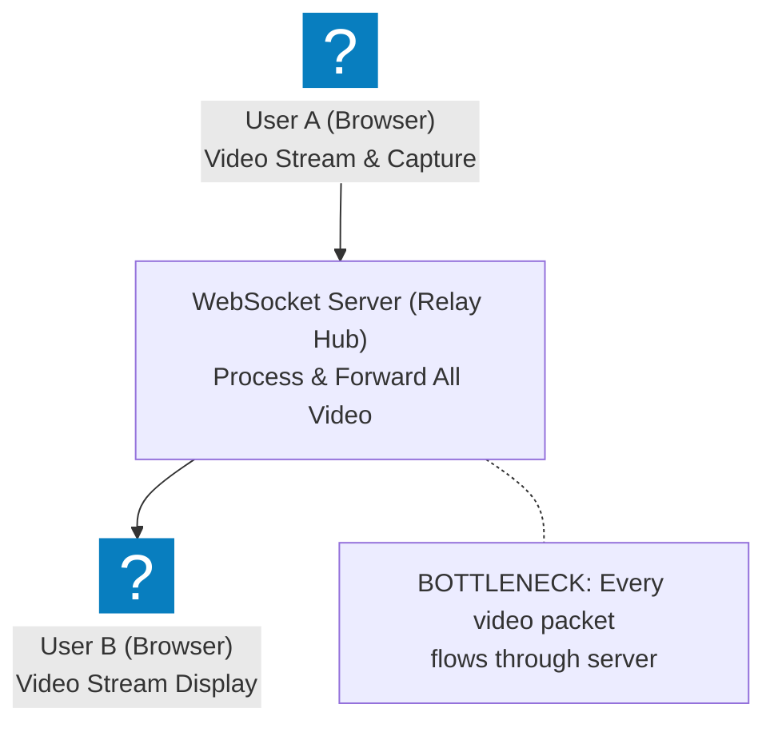
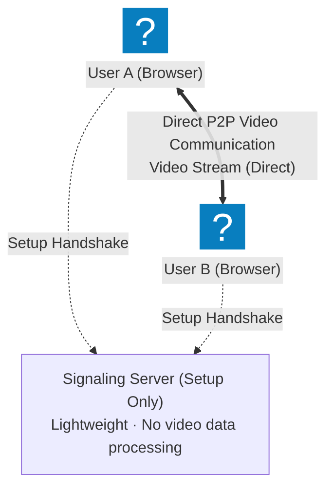
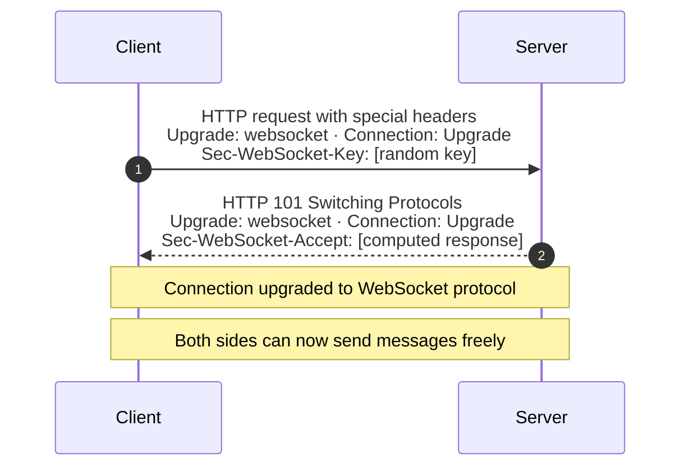
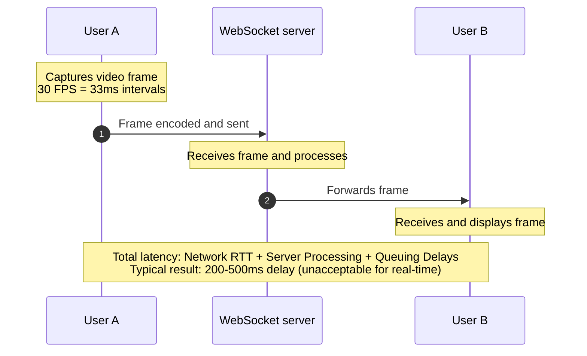
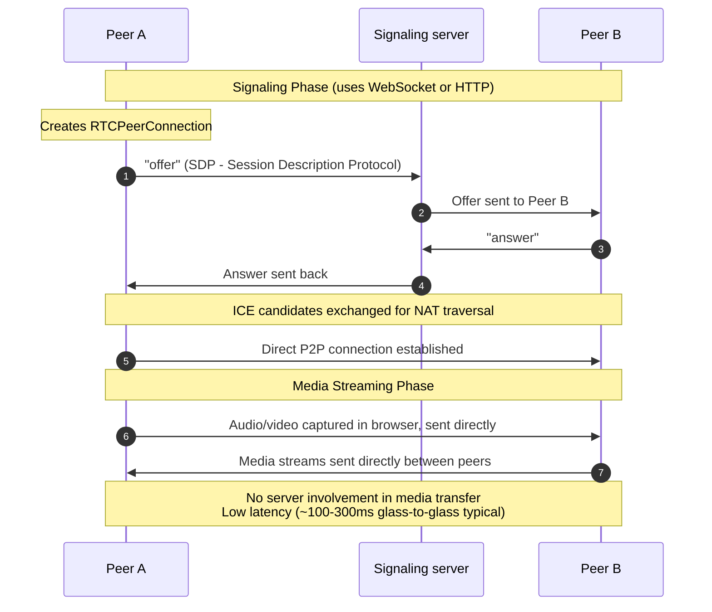
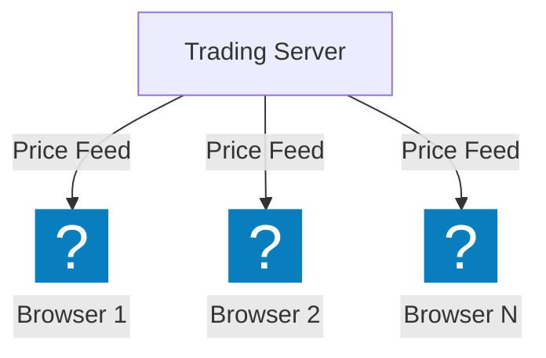
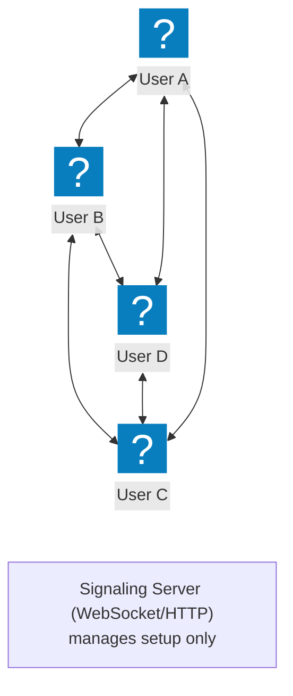
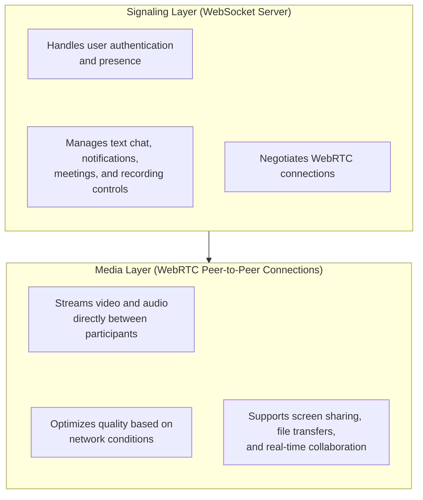
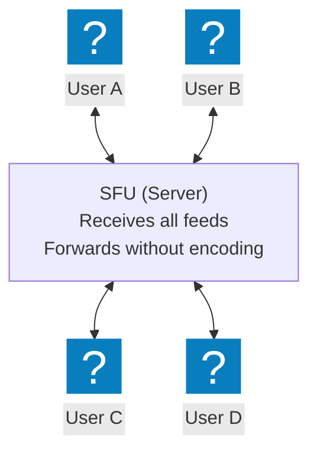
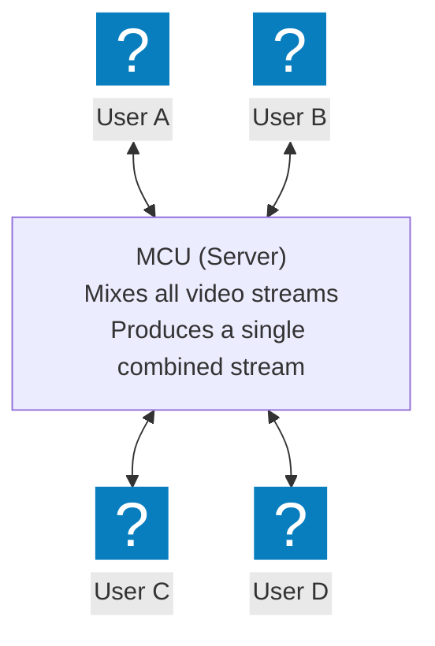

## Understanding the Problem: The Battle for Real-Time Supremacy

Meet **Emma Rodriguez**, CTO of **ConnectNow**, a promising startup building the next generation of virtual collaboration tools. With remote work exploding post-2020, her team is racing to create a platform that combines video conferencing, screen sharing, and real-time document collaboration—all in a single web application.

At 3 AM during a crucial investor demo preparation, disaster strikes. Their video calling feature, built entirely on **WebSockets**, starts stuttering and failing under load. While their text chat works flawlessly, the video streams become unwatchable pixelated messes with 3-second delays. Emma realizes they've chosen the wrong tool for the job, and tomorrow's $5M funding round hangs in the balance.

**The Technical Crisis:**
- **Video quality**: Dropping to 240p with severe pixelation
- **Latency**: 2-5 second delays making conversations impossible
- **Server load**: CPU hitting 95% with just 50 concurrent video calls
- **Bandwidth costs**: Skyrocketing as all video routes through their servers
- **User experience**: Investors losing confidence in real-time

**Our Mission:** Understand when to use WebSockets versus WebRTC for video communication, and why making the wrong choice can kill your business before it starts.

---

## The Architecture Showdown: Client-Server vs Peer-to-Peer

**ConnectNow's Original WebSocket Architecture:**


**The Better WebRTC Architecture:**


---

## WebSockets: The Reliable Workhorse

### How WebSockets Work: The TCP Foundation

WebSockets provide a **persistent, full-duplex communication channel** between client and server over TCP. Think of it as upgrading a regular HTTP request-response into a permanent telephone line where both sides can talk anytime.

**The WebSocket Handshake Process:**


### WebSocket Strengths: Why They Excel

**Perfect for Text-Based Real-Time Communication:**
- **Guaranteed delivery**: TCP ensures every message arrives in order
- **Low overhead**: After handshake, minimal protocol overhead
- **Broad compatibility**: Supported by all modern browsers
- **Server-centric**: Easy to implement authentication, logging, and moderation

**Real-World WebSocket Success Stories:**

**Slack's Messaging Architecture**:
- Uses WebSockets for instant message delivery
- Handles typing indicators and read receipts
- Processes millions of messages daily with <100ms latency
- Server manages all message routing and history

**Discord's Communication Platform**:
- WebSockets for text chat and presence updates
- Real-time activity status and notifications
- Scales to millions of concurrent users
- Central server manages all user state

### WebSocket Limitations for Video

**The Video Streaming Problem:**


**Resource Consumption Issues:**
- **Server CPU**: Must process every video frame
- **Bandwidth costs**: All video data flows through servers
- **Memory usage**: Buffering video streams for multiple users
- **Scaling challenges**: Each additional user multiplies server load

---

## WebRTC: The Peer-to-Peer Powerhouse

### How WebRTC Works: Direct Communication Magic

WebRTC (Web Real-Time Communication) enables **direct peer-to-peer connections** between browsers for audio, video, and data. It's designed specifically for real-time media streaming with ultra-low latency.

**WebRTC Connection Establishment:**


### The NAT Traversal Challenge

**Why Direct P2P is Complex:**
Most devices sit behind NAT (Network Address Translation) firewalls that block direct connections. WebRTC solves this through:

**STUN Servers** (Session Traversal Utilities for NAT):
- Help discover public IP addresses
- Enable direct connections when possible
- Lightweight and cheap to operate

**TURN Servers** (Traversal Using Relays around NAT):
- Relay traffic when direct connection impossible
- Used as fallback (~10-20% of connections)
- More expensive but ensures connectivity

### WebRTC Strengths: Built for Media

**Optimized for Real-Time Media:**
- **UDP-based**: Prioritizes speed over guaranteed delivery
- **Built-in codecs**: Efficient video/audio compression (H.264, VP8, Opus)
- **Adaptive bitrate**: Automatically adjusts quality based on network conditions
- **Minimal latency**: Direct P2P adds little beyond network transit (often <50ms nearby); ~100-300ms glass-to-glass including capture, encoding and jitter buffer

**Real-World WebRTC Success Stories:**

**Google Meet's Architecture**:
- Uses WebRTC for all video/audio streams
- Handles millions of concurrent calls
- Automatic quality adaptation based on network conditions
- Routes group calls through Google's own media servers (SFUs) worldwide: WebRTC doesn't mean serverless

**Zoom's Hybrid Approach**:
- WebRTC for browser-based clients
- Custom protocols for native apps
- Intelligent routing between P2P (two-person meetings) and server relay
- Relies on its own global data-center network for low latency

### WebRTC Limitations

**Implementation Complexity:**
- **Signaling required**: Need separate server for connection setup
- **NAT traversal**: STUN/TURN servers required for reliability
- **Browser compatibility**: Some API differences between browsers
- **Media handling**: Complex codec negotiation and error handling

**Scalability Challenges:**
- **P2P limits**: Direct connections don't scale beyond small groups
- **Server fallback**: Need infrastructure for TURN relay scenarios
- **Multi-party complexity**: Mesh networks become inefficient with many participants

---

## The Great Comparison: When to Choose What

### Performance and Latency Analysis

| Metric | WebSockets | WebRTC | Winner |
|--------|------------|---------|---------|
| **Text Chat Latency** | 50-100ms | 50-100ms (via data channels) | Tie |
| **Video Streaming Latency** | 200-500ms+ (seconds under packet loss) | ~100-300ms typical | **WebRTC** |
| **Audio Quality** | Depends on server processing | Optimized codecs | **WebRTC** |
| **Server Resource Usage** | High (processes all media) | Low (signaling only) | **WebRTC** |
| **Bandwidth Costs** | High (all traffic via server) | Low (direct P2P) | **WebRTC** |
| **Implementation Complexity** | Low | High | **WebSockets** |

### Use Case Decision Matrix

#### Choose WebSockets When:

**Real-Time Text Communication**:
- **Chat applications**: Slack, Discord, WhatsApp Web
- **Collaborative editing**: Figma, Notion
- **Live updates**: Stock prices, sports scores, notifications
- **Gaming**: Turn-based games, chat systems

**Why WebSockets Win Here:**
- Guaranteed message delivery via TCP
- Server can enforce business logic and moderation
- Easy to implement authentication and logging
- Messages can be persisted and replayed

**Example Architecture - Live Trading Platform:**


WebSocket Use Case: Real-time stock price updates

Advantages:
- ✅ Guaranteed delivery of price updates
- ✅ Server can enforce rate limiting
- ✅ Easy to implement price history
- ✅ Can handle millions of concurrent price feeds

#### Choose WebRTC When:

**Real-Time Media Communication**:
- **Video conferencing**: Zoom, Google Meet, Teams
- **Live streaming**: interactive, low-latency streams (big platforms like Twitch and YouTube Live mainly deliver via HLS)
- **Screen sharing**: Remote desktop, presentations
- **Gaming**: Real-time multiplayer with voice chat
- **IoT streaming**: Security cameras, baby monitors

**Why WebRTC Wins Here:**
- Ultra-low latency for media streams
- Built-in media codecs and quality adaptation
- Direct P2P reduces server costs
- Optimized for audio/video processing

**Example Architecture - Video Conferencing:**


WebRTC Use Case: 4-person video call

Advantages:
- ✅ ~100-300ms video latency
- ✅ Direct P2P connections
- ✅ Automatic quality adaptation
- ✅ Built-in security and encryption

---

## The Hybrid Architecture: Best of Both Worlds

### ConnectNow's Winning Solution

After the investor demo disaster, Emma's team implemented a **hybrid architecture** that uses both technologies strategically:



### Implementation Strategy

**Phase 1: WebSocket Foundation**
```
// WebSocket handles signaling and chat
const signalingSocket = new WebSocket('wss://connectnow.com/signaling');

signalingSocket.onmessage = (event) => {
    const message = JSON.parse(event.data);
    
    switch(message.type) {
        case 'offer':
            handleWebRTCOffer(message.offer);
            break;
        case 'answer':
            handleWebRTCAnswer(message.answer);
            break;
        case 'ice-candidate':
            handleICECandidate(message.candidate);
            break;
        case 'chat-message':
            displayChatMessage(message);
            break;
        case 'user-joined':
            updateUserList(message.users);
            break;
    }
};
```

**Phase 2: WebRTC Media Streams**
```
// WebRTC handles direct video/audio
const peerConnection = new RTCPeerConnection({
    iceServers: [
        { urls: 'stun:stun.connectnow.com:3478' },
        { 
            urls: 'turn:turn.connectnow.com:3478',
            username: 'connectnow-user',
            credential: 'secure-token'
        }
    ]
});

// Get user media and add to peer connection
navigator.mediaDevices.getUserMedia({ video: true, audio: true })
    .then(stream => {
        localVideo.srcObject = stream;
        stream.getTracks().forEach(track => {
            peerConnection.addTrack(track, stream);
        });
    });

// Handle incoming remote streams
peerConnection.ontrack = (event) => {
    remoteVideo.srcObject = event.streams[0];
};
```

### Results: From Disaster to Success

**Before (WebSocket-only video):**
- Video latency: 2-5 seconds
- Server CPU: 95% with 50 users
- Bandwidth costs: $0.50 per user per hour
- Video quality: 240p maximum
- Investor confidence: Low

**After (Hybrid architecture):**
- Video latency: <100ms
- Server CPU: 15% with 500 users
- Bandwidth costs: $0.05 per user per hour
- Video quality: 1080p adaptive
- Investor confidence: Series A funded!

---

## Real-World War Stories: Learning from Failures and Successes

### The Telemedicine Disaster: When Latency Kills

**MedConnect's Crisis** (a composite example):
A telemedicine startup built their platform using WebSockets for video calls between doctors and patients. During the COVID-19 surge:

**The Problem:**
- Video delays of 3-5 seconds made medical consultations unusable
- Doctors couldn't properly examine patients due to lag
- Emergency consultations became dangerous due to communication delays
- Patient satisfaction scores plummeted to 2.1/5 stars

**The Solution:**
- Migrated to WebRTC for all video/audio communication
- Kept WebSockets for appointment scheduling and text notes
- Implemented adaptive bitrate for poor network conditions
- Added TURN servers for patients behind restrictive firewalls

**The Results:**
- Video latency reduced to <200ms
- Patient satisfaction improved to 4.7/5 stars
- Able to handle 10x more concurrent consultations
- Became the preferred platform for major hospital networks

### The Gaming Platform Success: Discord's Hybrid Mastery

**Discord's Architecture Genius**:
Discord perfectly demonstrates the hybrid approach:

**WebSockets for:**
- Text chat in channels (millions of messages daily)
- User presence and status updates
- Server management and permissions
- Bot integrations and commands

**WebRTC for:**
- Voice channels with crystal-clear audio
- Video calls and screen sharing
- Low-latency game streaming (Go Live)
- Media relayed through Discord's own voice servers (SFUs), not peer-to-peer

**The Results:**
- Supports 150+ million monthly active users (2021 figure)
- Millions of concurrent voice users on low-latency voice
- Text messages delivered in near real time
- Scales globally on its own fleet of voice servers

### The Emergency Response Revolution: Carbyne's Life-Saving Tech

**Carbyne's 911 System**:
Emergency services require ultra-low latency for life-or-death situations:

**The Challenge:**
- 911 calls need instant video from accident scenes
- Every second of delay could mean the difference between life and death
- Must work reliably under network stress and poor conditions
- Need to distribute video to multiple emergency responders simultaneously

**The Solution** (the typical design for this kind of system; Carbyne's internals are simplified here):
- WebRTC for initial ultra-low latency video capture (<500ms)
- Immediate streaming from caller's phone to 911 operator
- WebSocket signaling for call setup and metadata
- Hybrid relay system for distribution to paramedics and hospitals

**The Impact:**
- Callers stream live video from a browser link, with no app install
- Enables remote medical guidance during critical situations
- Dispatchers see the scene instead of relying on a verbal description

---

## Advanced Patterns and Optimization Strategies

### Scaling WebRTC: Beyond Simple P2P

**The Mesh Network Problem:**
```
4-Person Call Bandwidth Requirements:
- Each person sends video to 3 others
- Each person receives video from 3 others
- Total: 6 video streams per person
- With 1080p: ~18 Mbps per participant

10-Person Call:
- Each person: 18 video streams
- Total: ~54 Mbps per participant
- Most home internet: 10-25 Mbps upload
- Result: Impossible!
```

**Solution 1: Selective Forwarding Unit (SFU)**


Advantages:
- ✅ Each user uploads once, receives multiple streams
- ✅ Server doesn't encode/decode (lower CPU)
- ✅ Scales to 50+ participants
- ✅ Lower bandwidth per participant

**Solution 2: Multipoint Control Unit (MCU)**


Advantages:
- ✅ Ultra-low bandwidth (one stream per user)
- ✅ Consistent quality for all participants
- ✅ Can add effects and branding
- ❌ High server CPU usage
- ❌ Introduces additional latency

### Network Optimization Techniques

**Adaptive Bitrate Streaming:**
```
// Monitor connection quality and adapt
const connection = peerConnection.getStats()
    .then(stats => {
        stats.forEach(report => {
            // remote-inbound-rtp = the peer's report on OUR outgoing video
            // (inbound-rtp would describe what we receive, not what we send)
            if (report.type === 'remote-inbound-rtp' && report.kind === 'video') {
                const lossRate = report.fractionLost;
                
                if (lossRate > 0.05) {
                    // High packet loss - reduce quality
                    adjustVideoQuality('low');
                } else if (lossRate < 0.01) {
                    // Good connection - increase quality
                    adjustVideoQuality('high');
                }
            }
        });
    });

function adjustVideoQuality(quality) {
    const sender = peerConnection.getSenders()
        .find(s => s.track && s.track.kind === 'video');
    
    const params = sender.getParameters();
    
    if (quality === 'low') {
        params.encodings[0].maxBitrate = 300000; // 300 kbps
    } else if (quality === 'high') {
        params.encodings[0].maxBitrate = 2000000; // 2 Mbps
    }
    
    sender.setParameters(params);
}
```

### Security and Privacy Considerations

**WebRTC Security Advantages:**
- **Mandatory encryption**: All media streams encrypted by default using DTLS-SRTP (end-to-end in P2P; an SFU decrypts unless you add E2EE via Insertable Streams)
- **Identity verification**: Cryptographic fingerprints prevent man-in-the-middle attacks
- **Secure by design**: No media data touches servers in P2P mode

**WebSocket Security Requirements:**
- **WSS (Secure WebSocket)**: Must use TLS encryption for production
- **Authentication**: Server-side validation of all messages
- **Rate limiting**: Prevent spam and DoS attacks
- **Input validation**: Sanitize all incoming data

**Hybrid Security Architecture:**
```
// Secure WebSocket connection for signaling
// (browsers can't set custom headers on a WebSocket: authenticate in the first message)
const signalingSocket = new WebSocket('wss://api.connectnow.com/signaling');
signalingSocket.onopen = () => signalingSocket.send(JSON.stringify({
    type: 'auth',
    token: jwtToken,
    clientVersion: '2.1.0'
}));

// WebRTC with secure TURN authentication
const rtcConfig = {
    iceServers: [
        { urls: 'stun:stun.connectnow.com:3478' },
        {
            urls: 'turn:turn.connectnow.com:3478',
            username: generateTurnUsername(),
            credential: generateTurnCredential(), // Time-limited token
            credentialType: 'password'
        }
    ],
    iceCandidatePoolSize: 10
};
```

---

## Implementation Guidelines and Best Practices

### The Decision Tree: Choosing Your Technology Stack

```
Real-Time Communication Requirements:
├── Primary Use Case?
│   ├── Text/Data Communication
│   │   ├── Chat applications → WebSockets
│   │   ├── Live updates (stocks, sports) → WebSockets
│   │   ├── Collaborative editing → WebSockets
│   │   └── Notifications → WebSockets
│   │
│   └── Media Communication  
│       ├── Video conferencing → WebRTC
│       ├── Live streaming (interactive) → WebRTC
│       ├── Screen sharing → WebRTC
│       └── File transfer → WebRTC DataChannels
│
├── Latency Requirements?
│   ├── Conversational (<~300ms) → WebRTC
│   ├── <500ms acceptable → Either
│   └── >500ms acceptable → WebSockets
│
├── Scaling Requirements?
│   ├── ≤4 participants → WebRTC P2P mesh
│   ├── 5-100 participants → WebRTC + SFU
│   ├── 100+ participants → WebRTC + cascaded SFUs (MCU if clients can decode only one stream)
│   └── Broadcast (1-to-many) → WebRTC/RTMP ingest + HLS via CDN
│
└── Infrastructure Budget?
    ├── Low budget → WebRTC (P2P saves bandwidth)
    ├── Medium budget → Hybrid approach
    └── High budget → Custom optimized solution
```

### Development and Testing Strategy

**Phase 1: Start Simple**
```
// Begin with basic WebSocket chat
const basicSocket = new WebSocket('wss://yourapp.com/chat');
basicSocket.onmessage = (event) => {
    const message = JSON.parse(event.data);
    displayMessage(message.text, message.user);
};

// Test with multiple browser tabs locally
// Validate message delivery and ordering
// Implement reconnection logic
```

**Phase 2: Add WebRTC Gradually**
```
// Start with audio-only WebRTC
navigator.mediaDevices.getUserMedia({ audio: true })
    .then(stream => {
        // Add audio track to peer connection
        // Test on same network first
        // Then test across different networks
    });

// Expand to video once audio is stable
// Add screen sharing as final feature
```

**Phase 3: Optimize and Scale**
```
// Implement connection quality monitoring
// Add adaptive bitrate streaming
// Set up TURN servers for production
// Load test with realistic user scenarios
```

### Common Pitfalls and How to Avoid Them

**WebSocket Pitfall #1: Using for Media Streaming**
```
// ❌ DON'T: Stream video through WebSocket
socket.send(JSON.stringify({
    type: 'video-frame',
    data: videoFrame, // Huge payload!
    timestamp: Date.now()
}));

// ✅ DO: Use WebSocket for signaling only
socket.send(JSON.stringify({
    type: 'webrtc-offer',
    sdp: offer.sdp,
    userId: currentUser.id
}));
```

**WebRTC Pitfall #1: Forgetting TURN Servers**
```
// ❌ DON'T: STUN servers only (fails for ~20% of users)
const rtcConfig = {
    iceServers: [{ urls: 'stun:stun.l.google.com:19302' }]
};

// ✅ DO: Include TURN servers for reliability
const rtcConfig = {
    iceServers: [
        { urls: 'stun:stun.l.google.com:19302' },
        { 
            urls: 'turn:your-turn-server.com:3478',
            username: 'user',
            credential: 'pass'
        }
    ]
};
```

**WebRTC Pitfall #2: Not Handling Connection States**
```
// ❌ DON'T: Ignore connection state changes
peerConnection.oniceconnectionstatechange = null;

// ✅ DO: Monitor and handle all states
peerConnection.oniceconnectionstatechange = () => {
    switch(peerConnection.iceConnectionState) {
        case 'connected':
            showConnectionStatus('Connected');
            break;
        case 'disconnected':
            showConnectionStatus('Reconnecting...');
            break;
        case 'failed':
            showConnectionStatus('Connection failed');
            // Attempt reconnection
            restartICE();
            break;
    }
};
```

---

## The Future of Real-Time Communication

### Emerging Technologies and Trends

**WebRTC-NV (Next Version)**:
- **AV1 codec support**: 50% better compression than H.264
- **Machine learning integration**: AI-powered noise cancellation and video enhancement
- **5G optimization**: Ultra-low latency for mobile applications
- **IoT integration**: Direct browser-to-device communication

**WebTransport: The Next Evolution**
```
// WebTransport (HTTP/3) combines best of both worlds
const transport = new WebTransport('https://api.example.com/webtransport');
await transport.ready;
const encoder = new TextEncoder();  // streams and datagrams carry bytes, not strings

// Reliable streams (like WebSocket)
const reliableStream = await transport.createBidirectionalStream();
reliableStream.writable.getWriter().write(encoder.encode('reliable message'));

// Unreliable datagrams (like WebRTC)
const datagramWriter = transport.datagrams.writable.getWriter();
datagramWriter.write(encoder.encode('low-latency data'));
```

### Industry Trends and Predictions

**The Hybrid Architecture Revolution** (predictions, not measured data):
- **2025-2026**: 80% of new real-time apps will use hybrid WebSocket+WebRTC architectures
- **2026-2027**: Edge computing integration for sub-20ms global latency
- **2027-2028**: AI-powered automatic technology selection based on use case

---

## Summary: The Technology Choice That Changes Everything

The battle between WebSockets and WebRTC isn't about one technology being superior—it's about choosing the right tool for the specific job. Emma's ConnectNow startup learned this lesson the hard way, but their recovery story demonstrates the power of understanding each technology's strengths.

**The Golden Rules:**

1. **Use WebSockets for reliable data communication**: Text chat, notifications, collaborative editing, and any scenario where message delivery guarantees matter more than ultra-low latency.

2. **Use WebRTC for real-time media**: Video calls, interactive live streaming, screen sharing, and any application where conversational latency (a few hundred milliseconds at most) is critical for user experience.

3. **Embrace hybrid architectures**: The most successful platforms use WebSockets for signaling and control, WebRTC for media streams, creating the best of both worlds.

4. **Plan for scale from day one**: Whether it's WebSocket connection limits or WebRTC mesh network bandwidth explosion, understand the scaling challenges before they hit production.

**The Business Impact:**

Choosing the wrong technology can kill promising startups:
- **WebSocket-only video**: High latency, poor quality, expensive servers
- **WebRTC-only text**: Over-engineered, complex implementation, unnecessary overhead
- **Hybrid approach**: Optimal performance, cost-effective scaling, best user experience

**The Technical Truth:**

- **WebSockets excel at reliable, server-mediated communication** where TCP's guarantees and central control are valuable
- **WebRTC dominates real-time media streaming** where UDP's speed and direct P2P connections minimize latency
- **The future belongs to hybrid architectures** that leverage each technology's strengths

**The Ultimate Lesson:**

Technology choices aren't just technical decisions—they're business decisions. The difference between ~150ms and multi-second video latency isn't just numbers on a monitoring dashboard; it's the difference between a $5M funding round and a failed startup. Understanding when to use WebSockets versus WebRTC isn't just about knowing protocols; it's about understanding user experience, scaling economics, and competitive advantage.

Emma's team learned that the most elegant solution often isn't choosing one technology over another—it's orchestrating multiple technologies to create something greater than the sum of its parts. In the world of real-time communication, the winners aren't those who pick the "best" technology, but those who pick the right combination of technologies for their specific challenge.

**The Final Truth**: In real-time communication, latency isn't just a technical metric—it's the difference between human connection and digital frustration. Choose WebSockets when reliability matters most, choose WebRTC when latency matters most, and choose hybrid architectures when you want to win in the market.
